<!-- Generated from docs/ux-surfaces.yaml by scripts/ux_surface_map.py. Do not edit: change the map and re-run. -->

# UX surface map: facilitation-suite

Every surface a person can reach in this app, each under a stable id that its root element carries as `data-surface`. Each area has a diagram of how its surfaces connect; a rounded node is a surface in another area.

The checklist of everything a person can see and do in facilitation-suite: every tab, drill-in, card, sheet, dialog, menu, Settings group, live-cockpit card, stage rendering, phone-remote screen and quiz-player screen, with how it is reached, what is on it and what each control does. [Sessions](sessions.md), [Plan](planning.md), [Groups](groups.md), [Results](results.md), [Settings](settings.md), [the live cockpit](live.md), [the phone remote](phone-remote.md) and [the quiz player](quiz-player.md) tell each story in prose; this page is the exhaustive index, so a layout change can check every surface and not only the ones a reviewer happens to open.

**Keeping it true.** A change that adds, removes, renames or reshapes a user-visible surface (a tab, card, sheet, dialog, menu, Settings group or row that opens something, cockpit card, stage rendering or remote/player screen) updates its entry in `docs/ux-surfaces.yaml` in the same change, adds or removes the matching `data-surface`, and regenerates this page with `python scripts/ux_surface_map.py`; this page is never edited by hand. The rule is in `CLAUDE.md`, and `scripts/ux_surface_ratchet.py` holds it in the gate.

**Ids.** `<area>.<surface>`, the form the e2e `surface(page, "<id>")` hook takes. An id never changes when a title is reworded; one id names one surface even when it is drawn two ways. The three generic dialog builders in `static/js/dialogs.js` stamp one id for the kind (`dialog.form`, `dialog.confirm`, `dialog.row-menu`); each caller's dialog is its own entry with `root: none` and a link to its kind, since the kind's element is the only root the code carries. A sheet is stamped by its caller (`sheet.dlg.dataset.surface`). A surface built by a vendored component carries the component's own id (`app.update-banner`).

**Five pages, three audiences.** The app (`/`, port 8449) is the facilitator's planning and review tool; the presenter (`/presenter`) is the live cockpit on the second monitor; the stage (`/stage`) is what Zoom sees, in the session's own theme; the phone remote (`/remote`) is the cockpit's buttons on a phone over Tailscale; the quiz player (`/play`, its own public port) is what a participant's phone shows. The app, presenter and remote follow the fleet design and the appearance setting; the stage and the player do not.

**Layout bands** (the app and the remote share the vendored nav):

| Band | Condition | Nav | Panes |
| --- | --- | --- | --- |
| Phone | touch pointer, up to 520px | the floating bottom pill | one column; Plan, Groups and Results stack their list above their detail |
| Narrow or mid window | a mouse below 1100px, or a touch device wider than 520px | an inline segmented control pinned at the top | one column, stacked |
| Wide | 1100px and up with a mouse | the left rail | Plan, Groups and Results are split panes (list left, detail right); Sessions keeps its 772px measure |

**Input modes.** Everything is reachable with a mouse and with touch. The keyboard reaches the Plan outline (arrows, Alt+arrows, Ctrl+A, Ctrl+D, H, Delete, Esc), the presenter and stage (the keys sheet) and every dialog (Esc closes). Drag and drop (Plan rows and sections) is mouse only; the row menu does the same moves for touch.

**Gating.** The Copilot card, its overlay and recordings, the quiz blocks, the music card and the quiz chips only appear when the session or the machine has them; each entry says when. A browser that blocks the clipboard gets a selected field and a toast instead of a silent failure.

**Where state lives.** The open session, the last tab and the theme ride `localStorage`; a deep link (`/#sessions/<id>`, `/#settings/<section>`) rides the URL; everything else lives in the session folder or the server. The phone remote remembers only whether its hint strip is folded.

Walked 2026-11-18 against build `0d935a0`, at widths 390, 1280, themes light, dark.

## Areas

| Area | Surfaces |
|---|---|
| [App chrome](#app-chrome) | 6 |
| [Dialog builders](#dialog-builders) | 3 |
| [PowerPoint import](#powerpoint-import) | 1 |
| [Sessions](#sessions) | 14 |
| [Plan](#plan) | 28 |
| [Groups](#groups) | 4 |
| [Results](#results) | 13 |
| [Settings](#settings) | 20 |
| [Presenter cockpit](#presenter-cockpit) | 30 |
| [Stage](#stage) | 14 |
| [Phone remote](#phone-remote) | 10 |
| [Quiz player](#quiz-player) | 8 |

## App chrome

The frame every tab shares: the nav, the page header, the build footer and the deep links.

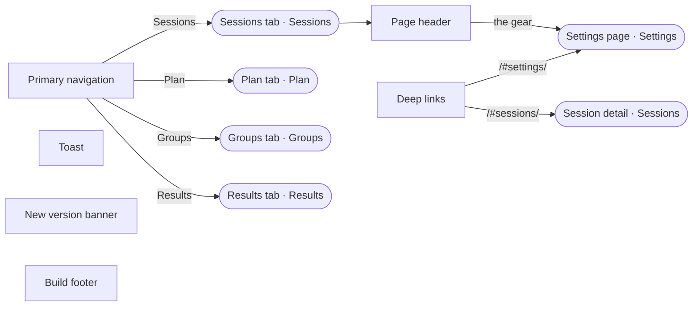

### `chrome.nav` Primary navigation

- **Root:** `data-surface`
- **Reach:** every page of the app; the same markup on the phone remote with three tabs
- **Holds:** Sessions · Plan · Groups · Results, each an icon and a label
- **Does:**
  - a tap switches the pane and remembers it (`localStorage`) for the next visit
  - the arrow keys move between tabs (the vendored tablist)
- **Phone:** the floating glass pill at the bottom of the screen, hidden while a modal is open
- **Desktop:** a segmented control pinned at the top below 1100px; a left rail from 1100px with a mouse
- **Why:** the fleet navigation contract: one nav, one place, on every device
- **Leads to:**
  - [Sessions tab](#sessionstab-sessions-tab) (Sessions)
  - [Plan tab](#plantab-plan-tab) (Plan)
  - [Groups tab](#groupstab-groups-tab) (Groups)
  - [Results tab](#resultstab-results-tab) (Results)

### `chrome.header` Page header

- **Root:** `data-surface`
- **Reach:** the top of every tab, drawn by `pageHead`
- **Holds:**
  - the tab's icon and title
  - a status line (how many sessions, sections and minutes, people present)
  - the theme toggle
  - the Settings gear
- **Does:**
  - the toggle flips light and dark for every device at once
  - the gear opens Settings over the current tab
- **States:** the status line is empty until the tab has read its data
- **Leads to:** [Settings page](#settingspane-settings-page) (the gear)

### `chrome.toast` Toast

- **Root:** none — the vendored toast element, one `#toast` per page; a message appears and goes by itself
- **Reach:** any save, copy, error or background job result on the app, the presenter and the remote
- **Holds:** one line of text; an error is drawn in the danger colour
- **States:** a failed clipboard write says so and leaves the text selected

### `app.update-banner` New version banner

- **Root:** `data-surface`
- **Reach:** the app notices the server moved to a newer build while the page was open
- **Holds:**
  - "New version available"
  - Reload
  - a dismiss cross
- **Does:**
  - Reload reloads the page (only ever the person's tap)
  - dismiss keeps it down until the server moves to yet another build
- **Why:** the vendored `build-watch` stamps this id itself, so no app code carries it

### `chrome.build-readout` Build footer

- **Root:** none — a line in the page foot, no root of its own
- **Reach:** the foot of every tab, and the About group in Settings
- **Holds:** "Build: <sha> · <time>", or "Build: unknown" when the version could not be read

### `chrome.deep-links` Deep links

- **Root:** none — URLs, not elements
- **Reach:**
  - `/#sessions/<id>` opens that session full pane
  - `/#settings` and `/#settings/<section>` (appearance, stage, music, live, about) open Settings at that section
  - `/presenter?session=<id>` goes live with that session
- **Does:** the presenter's music chip and the Copilot panel's links use them to open the app's window
- **Leads to:**
  - [Session detail](#sessionsdetail-session-detail) (/#sessions/<id>)
  - [Settings page](#settingspane-settings-page) (/#settings/<section>)

## Dialog builders

The three generic builders in `static/js/dialogs.js`. A caller's own dialog is listed in its area with `root: none` and a link here.

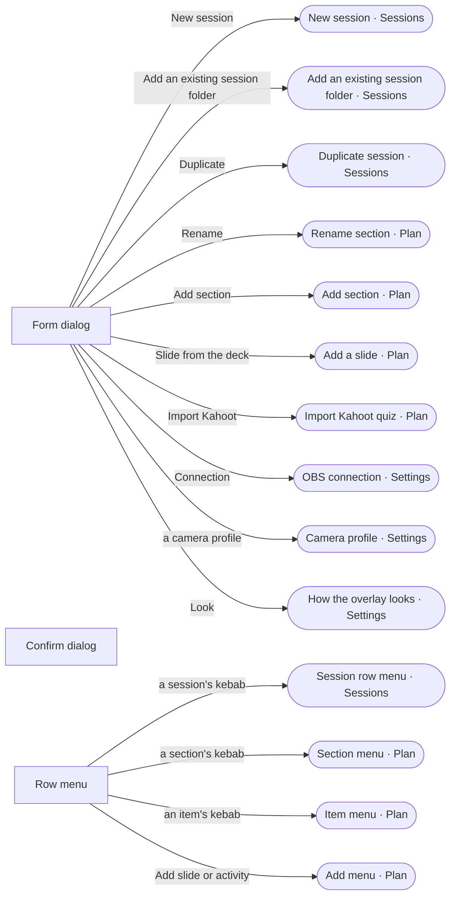

### `dialog.form` Form dialog

- **Root:** `data-surface`
- **Reach:** any editor that asks for a few fields: new session, rename, add a section, OBS settings, the overlay's look
- **Holds:**
  - a title and a close cross
  - one labelled row per field (text, number, date and time, colour, select, textarea), each with an optional hint
  - one Save button, disabled until the form is valid
- **Does:** Save resolves the values; Esc, the cross or a click on the backdrop dismisses with nothing
- **Why:** one `<dialog>` builder, never `window.prompt`, which would block the page
- **Leads to:**
  - [New session](#sessionsnew-session-new-session) (New session)
  - [Add an existing session folder](#sessionsadd-folder-add-an-existing-session-folder) (Add an existing session folder)
  - [Duplicate session](#sessionsduplicate-duplicate-session) (Duplicate)
  - [Rename section](#planrename-section-rename-section) (Rename)
  - [Add section](#plannew-section-add-section) (Add section)
  - [Add a slide](#planadd-slide-add-a-slide) (Slide from the deck)
  - [Import Kahoot quiz](#plankahoot-import-kahoot-quiz) (Import Kahoot)
  - [OBS connection](#settingsobs-connection-obs-connection) (Connection)
  - [Camera profile](#settingsobs-profile-camera-profile) (a camera profile)
  - [How the overlay looks](#settingsoverlay-look-how-the-overlay-looks) (Look)

### `dialog.confirm` Confirm dialog

- **Root:** `data-surface`
- **Reach:** any destructive or lossy step: remove from the ledger, delete, discard edits, reset, close, kick a player
- **Holds:**
  - a title and a close cross
  - one sentence saying what happens and what is kept
  - one action button, in the danger style when it destroys something
- **Does:** the action resolves true; Esc, the cross or the backdrop resolves false
- **Why:** the sentence always says what survives, so a confirmation is a decision and not a reflex

### `dialog.row-menu` Row menu

- **Root:** `data-surface`
- **Reach:** a kebab on a list row, the Plan's "Add slide or activity" button
- **Holds:**
  - one button per action with an icon and a label
  - a destructive action last, after a divider
- **Does:** a click runs the action and closes the menu; Esc or a click outside closes it
- **States:** opens upwards when the anchor is near the bottom of the window
- **Why:** design.md action-row: destructive last, after a divider
- **Leads to:**
  - [Session row menu](#sessionsrow-menu-session-row-menu) (a session's kebab)
  - [Section menu](#plansection-menu-section-menu) (a section's kebab)
  - [Item menu](#planitem-menu-item-menu) (an item's kebab)
  - [Add menu](#planadd-menu-add-menu) (Add slide or activity)

## PowerPoint import

The import dialog, shared by the Sessions tab and the Plan tab.

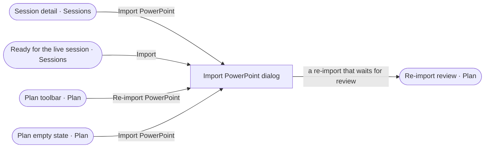

### `import.deck` Import PowerPoint dialog

- **Root:** `data-surface`
- **Reach:**
  - Sessions → the folder card's Import (or Re-import) PowerPoint
  - Plan → the toolbar's Import PowerPoint, Re-import PowerPoint or Re-import selected
  - the readiness row's Import
- **Holds:**
  - the deck path (typed, or picked with the native Windows dialog from Browse)
  - a sentence for what this run does (first import, re-import, selected slides)
  - a progress bar and the job's message
  - Import or Re-import
- **Does:**
  - Browse opens the native file picker on this PC
  - the job runs on the server and the bar follows each slide
  - a first import writes slides and the plan; a re-import stages an export for review
- **States:**
  - running: the dialog cannot be dismissed
  - failed: the bar turns red and the message says why; the server may still be running after a lost poll
- **Leads to:** [Re-import review](#planreimport-review-re-import-review) (a re-import that waits for review)

## Sessions

The ledger and one session opened full pane. The default tab.

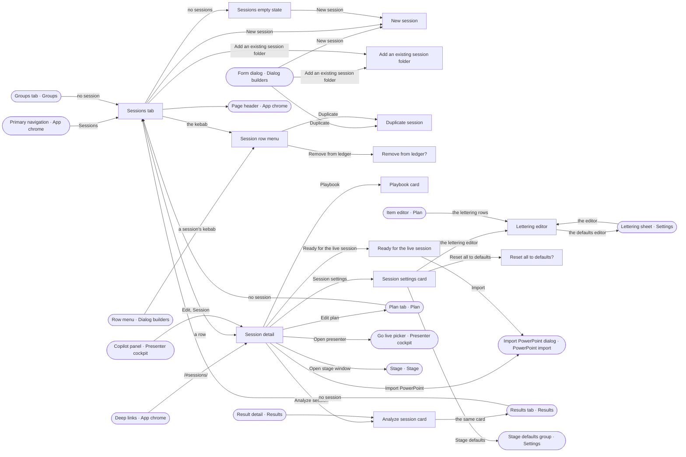

### `sessions.tab` Sessions tab

- **Root:** `data-surface`
- **Reach:**
  - the Sessions tab (the first visit)
  - the "Sessions" action of the empty Plan, Groups and Results
- **Holds:**
  - the page header
  - the ledger: an Upcoming group, then Past, each row the title, a date and the folder crumbs, with a kebab
  - New session
  - Add an existing session folder
  - a note that the list is only a ledger of names and folders
- **Does:**
  - a row opens the session full pane
  - New session and Add open their form dialogs
- **States:**
  - a folder that is missing or unreadable carries a red chip
  - the ledger could not be read: an error with Retry
- **Why:** the ledger holds only names and folders; every session lives in its own folder with its own session.yaml
- **Leads to:**
  - [Session detail](#sessionsdetail-session-detail) (a row)
  - [Session row menu](#sessionsrow-menu-session-row-menu) (the kebab)
  - [New session](#sessionsnew-session-new-session) (New session)
  - [Add an existing session folder](#sessionsadd-folder-add-an-existing-session-folder) (Add an existing session folder)
  - [Sessions empty state](#sessionsempty-sessions-empty-state) (no sessions)
  - [Page header](#chromeheader-page-header)

### `sessions.empty` Sessions empty state

- **Root:** none — a state of the ledger card, drawn inside `sessions.tab`
- **Reach:** a ledger with no sessions
- **Holds:** "No sessions yet." and a New session button
- **Leads to:** [New session](#sessionsnew-session-new-session) (New session)

### `sessions.row-menu` Session row menu

- **Root:** none — an instance of `dialog.row-menu`
- **Reach:** a session row's kebab
- **Holds:** Duplicate · Open folder · Remove from ledger (after a divider)
- **Does:** Open folder shows the folder in Explorer on this PC
- **Leads to:**
  - [Duplicate session](#sessionsduplicate-duplicate-session) (Duplicate)
  - [Remove from ledger?](#sessionsconfirm-remove-remove-from-ledger) (Remove from ledger)

### `sessions.new-session` New session

- **Root:** none — an instance of `dialog.form`
- **Reach:** New session on the Sessions tab, or in the empty state
- **Holds:** Title, Workshop folder, Session folder (the hint names where it is created), Date and time, Duration
- **Does:** Create session folder makes the folder under the session root and opens the session

### `sessions.add-folder` Add an existing session folder

- **Root:** none — an instance of `dialog.form`
- **Reach:** Add an existing session folder
- **Holds:** one Folder field (the folder that holds session.yaml)
- **Does:** Add to ledger opens it

### `sessions.duplicate` Duplicate session

- **Root:** none — an instance of `dialog.form`
- **Reach:** a session row's menu → Duplicate
- **Holds:** Title ("… (copy)") and Session folder
- **Does:** copies the plan, slides, roster and theme, not live data or exports

### `sessions.confirm-remove` Remove from ledger?

- **Root:** none — an instance of `dialog.confirm`
- **Reach:** a session row's menu → Remove from ledger
- **Holds:** the session's title, and that its folder and files stay where they are
- **Why:** removing only forgets the folder, so the confirmation says it is reversible

### `sessions.detail` Session detail

- **Root:** `data-surface`
- **Reach:**
  - a session row
  - `/#sessions/<id>`
  - Add or New session (opens the one just made)
- **Holds:**
  - the title, a one-line summary (date, duration planned, language on stage) and a close cross
  - the Session folder, Plan, Playbook, Analyze, Session settings and Ready cards
  - Open presenter and Open stage window
- **Does:**
  - the cross, Esc or Back returns to the list where it was scrolled
  - Open presenter goes live with this session; Open stage opens the stage window
- **States:**
  - reading: "Reading the session folder…"
  - the folder could not be read: an error with Retry
- **Why:** a session takes the whole pane so its own settings, readiness and go-live buttons sit together
- **Leads to:**
  - [Playbook card](#sessionsplaybook-playbook-card) (Playbook)
  - [Analyze session card](#sessionsanalyze-analyze-session-card) (Analyze session)
  - [Session settings card](#sessionssettings-session-settings-card) (Session settings)
  - [Ready for the live session](#sessionsreadiness-ready-for-the-live-session) (Ready for the live session)
  - [Import PowerPoint dialog](#importdeck-import-powerpoint-dialog) (Import PowerPoint)
  - [Plan tab](#plantab-plan-tab) (Edit plan)
  - [Go live picker](#presenterpicker-go-live-picker) (Open presenter)
  - [Stage](#stagelive-stage) (Open stage window)

### `sessions.playbook` Playbook card

- **Root:** `data-surface`
- **Reach:** inside the open session
- **Holds:**
  - the session folder's playbook.md rendered by the server
  - Edit, Reload and Show all / Show less
- **Does:**
  - Edit opens playbook.md in the default editor
  - Reload reads it again
  - Create playbook makes one
- **States:**
  - empty: "No playbook for this session yet" and Create playbook
  - loading, and an error with Retry
  - a long playbook is collapsed until Show all
- **Why:** the app shows the playbook; it never edits it

### `sessions.analyze` Analyze session card

- **Root:** `data-surface`
- **Reach:**
  - inside the open session
  - at the foot of the Results tab (the same card)
- **Holds:**
  - chips for what the analysis will find: playbook.md, notes.md, report/
  - a note, the draft when one exists
  - Run analysis
  - the command to paste into an agent session and Copy command
- **Does:**
  - Run analysis asks the hub for the report and polls while it runs
  - Copy command copies the analyze-session command
- **States:**
  - nothing captured yet: the buttons are disabled and the note says why
  - running, failed (hub down, timed out, no report, not saved) and a saved draft
- **Leads to:** [Results tab](#resultstab-results-tab) (the same card)

### `sessions.settings` Session settings card

- **Root:** `data-surface`
- **Reach:** inside the open session
- **Holds:**
  - Title, Date and time, Duration, Stage language, Stage hint, Capture scope (a switch)
  - the Stage look: Using the default or Overridden, Reset all to defaults, the colour set, then the lettering editor
- **Does:**
  - each field saves on blur, Enter or a select change, one at a time, and a refused save undoes it
  - the switch decides whether a capture stops when its activity is left
- **States:** Reset all to defaults only shows while the look differs from Settings → Stage defaults
- **Leads to:**
  - [Lettering editor](#sessionsstage-font-lettering-editor) (the lettering editor)
  - [Reset all to defaults?](#sessionsconfirm-look-reset-reset-all-to-defaults) (Reset all to defaults)
  - [Stage defaults group](#settingsstage-defaults-stage-defaults-group) (Stage defaults)

### `sessions.stage-font` Lettering editor

- **Root:** none — markup `font-editor.js` returns, drawn inside `sessions.settings` and the Settings lettering sheet
- **Reach:**
  - Session settings → Stage look
  - Settings → Stage defaults → Lettering and timers (the same editor on a sample of its own)
- **Holds:**
  - a live sample of the stage
  - Title font: font, weight, line thickness, colour, size
  - Text font: font, weight
  - Each kind of text: which font, capitals or as typed
  - Timer colours for the four states
- **Does:**
  - every change saves at once; the sample follows as you pick
  - a session shows "Differs from global" with Reset to global for a title size, capitals or font that departs from the default
- **Leads to:** [Lettering sheet](#settingslettering-lettering-sheet) (the defaults editor)

### `sessions.confirm-look-reset` Reset all to defaults?

- **Root:** none — an instance of `dialog.confirm`
- **Reach:** Session settings → Reset all to defaults
- **Holds:** says the colour set and lettering go back to Settings → Stage defaults, and that items with their own value keep it

### `sessions.readiness` Ready for the live session

- **Root:** `data-surface`
- **Reach:** inside the open session
- **Holds:**
  - "n of m" ready
  - one row per check (Slides, Activities, Roster, Groups, Files offline, Chat reader, OBS, Zoom auto-update, Copilot consent, and the quiz's public link when the plan has a quiz), each with an icon for ok, warn, to do or unknown and its detail
- **Does:** Import, Keep on PC, Test, Mark done and Check run the fix the row names
- **States:** a check that could not be established shows as unknown, never as ready
- **Leads to:** [Import PowerPoint dialog](#importdeck-import-powerpoint-dialog) (Import)

## Plan

The outline of sections and items (left) and the selected item's editor (right), plus the re-import review that replaces them.

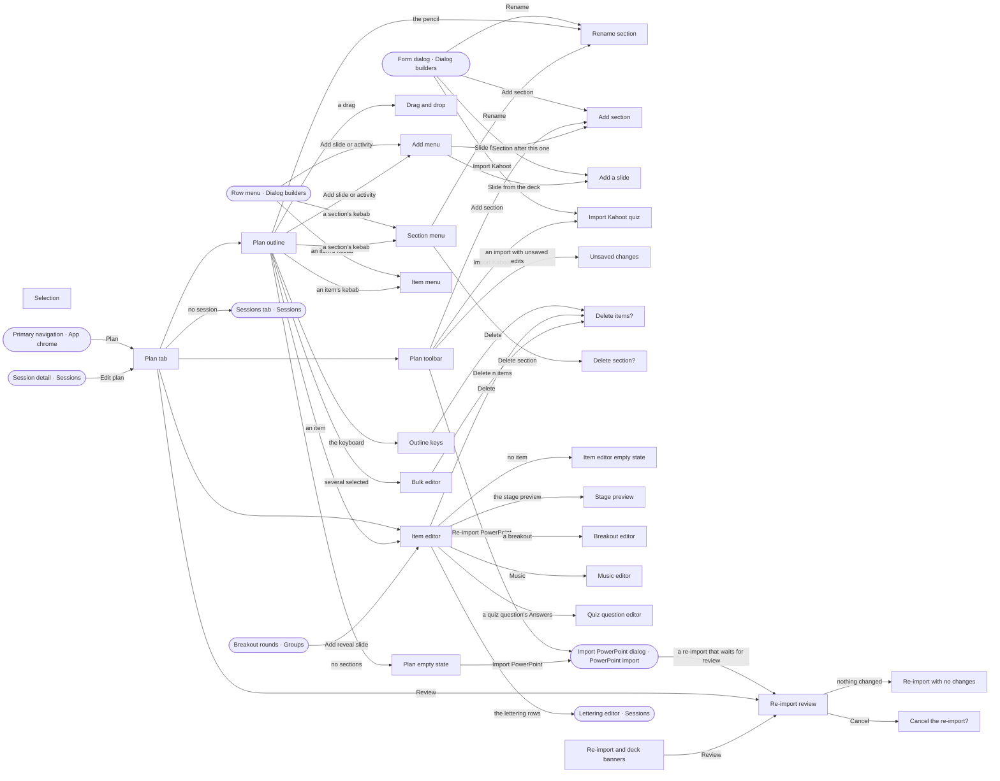

### `plan.tab` Plan tab

- **Root:** `data-surface`
- **Reach:**
  - the Plan tab
  - Sessions → the plan card's Edit plan
  - the Groups tab's Add reveal slide stages an item here
- **Holds:**
  - the header
  - the toolbar
  - the outline (left)
  - the item editor (right)
  - the re-import review, which replaces both while it is open
- **Does:** edits are staged in memory; Save to session.yaml is the one persistence boundary
- **States:**
  - no session picked: "Pick or create a session first." with a Sessions action
  - reading the plan, and an error with Retry
- **Phone:** the outline stacks above the editor
- **Desktop:** a split pane from 1100px: outline left, editor right
- **Leads to:**
  - [Plan toolbar](#plantoolbar-plan-toolbar)
  - [Plan outline](#planoutline-plan-outline)
  - [Item editor](#planeditor-item-editor)
  - [Re-import review](#planreimport-review-re-import-review) (Review)
  - [Sessions tab](#sessionstab-sessions-tab) (no session)

### `plan.toolbar` Plan toolbar

- **Root:** `data-surface`
- **Reach:** the top of the Plan tab
- **Holds:**
  - Re-import PowerPoint (or Import PowerPoint with no deck yet)
  - Re-import selected, only while the selection holds a slide
  - Add section
  - Import Kahoot
  - Collapse all · Expand all
  - "Planned h:mm of h:mm" and minutes on timers, in the warn colour when over
  - Unsaved changes with Discard and Save, while there are edits
- **Does:** Discard reloads the saved plan; Save writes session.yaml
- **Leads to:**
  - [Import PowerPoint dialog](#importdeck-import-powerpoint-dialog) (Re-import PowerPoint)
  - [Add section](#plannew-section-add-section) (Add section)
  - [Import Kahoot quiz](#plankahoot-import-kahoot-quiz) (Import Kahoot)
  - [Unsaved changes](#planconfirm-unsaved-unsaved-changes) (an import with unsaved edits)

### `plan.outline` Plan outline

- **Root:** `data-surface`
- **Reach:** inside the Plan tab
- **Holds:**
  - a header row per section: a grip, a fold chevron, the name, a rename pencil, the item count, the planned minutes (an inline number field) and a kebab
  - an item row per slide, activity, break or breakout: a number, a thumbnail, the title, chips (type, round, timer, music, lettering, "Pick profile") and a kebab
  - Add slide or activity under each open section
- **Does:**
  - click selects one item, Ctrl or Cmd+click adds or removes, Shift+click selects a range
  - drag moves an item (or the whole selection) or a section
  - a hidden item is dimmed with an eye-off mark
- **States:**
  - no sections: "Import the PowerPoint to start the plan." with an Import action
  - a collapsed section shows only its header
- **Why:** selection works as in a file manager so a bulk move or delete is the gesture people already know
- **Leads to:**
  - [Item editor](#planeditor-item-editor) (an item)
  - [Bulk editor](#planmultiselect-bulk-editor) (several selected)
  - [Section menu](#plansection-menu-section-menu) (a section's kebab)
  - [Item menu](#planitem-menu-item-menu) (an item's kebab)
  - [Add menu](#planadd-menu-add-menu) (Add slide or activity)
  - [Rename section](#planrename-section-rename-section) (the pencil)
  - [Plan empty state](#planempty-plan-empty-state) (no sections)
  - [Drag and drop](#plandrag-drag-and-drop) (a drag)
  - [Outline keys](#plankeys-outline-keys) (the keyboard)

### `plan.empty` Plan empty state

- **Root:** none — a state of the outline card, drawn inside `plan.outline`
- **Reach:** a session with no sections yet
- **Holds:** "Import the PowerPoint to start the plan." and Import PowerPoint
- **Leads to:** [Import PowerPoint dialog](#importdeck-import-powerpoint-dialog) (Import PowerPoint)

### `plan.drag` Drag and drop

- **Root:** none — a gesture, with no element of its own
- **Reach:** mouse only: drag an item row, a selection or a section header in the outline
- **Holds:** a drop target highlights; a drop on a section header moves to its end; a section dropped on another section's header moves it
- **Does:** dragging one selected row carries the whole selection
- **Why:** the row menus (Move up, Move down) and Alt+arrows do the same moves for touch and keyboard

### `plan.keys` Outline keys

- **Root:** none — keyboard paths, with no element of their own
- **Reach:** a focused item row
- **Holds:** Enter or Space selects · Up and Down move the focus · Shift+Up/Down extend the selection · Alt+Up/Down move the item · Ctrl+A selects all · Ctrl+D duplicates · H hides or shows · Delete or Backspace deletes · Esc keeps one
- **Leads to:** [Delete items?](#planconfirm-delete-delete-items) (Delete)

### `plan.section-menu` Section menu

- **Root:** none — an instance of `dialog.row-menu`
- **Reach:** a section header's kebab
- **Holds:** Rename · Add an activity here · Move up · Move down · Delete section (after a divider)
- **Leads to:**
  - [Rename section](#planrename-section-rename-section) (Rename)
  - [Delete section?](#planconfirm-delete-section-delete-section) (Delete section)

### `plan.item-menu` Item menu

- **Root:** none — an instance of `dialog.row-menu`
- **Reach:** an item row's kebab
- **Holds:** Hide slide / Show slide (by kind), or Hide 3 items for a selection
- **Does:** hiding skips the item with Next and Previous; the presenter can still open it

### `plan.add-menu` Add menu

- **Root:** none — an instance of `dialog.row-menu`
- **Reach:** Add slide or activity under a section
- **Holds:** Activity · Break · Breakout · Slide from the deck · Section after this one
- **Leads to:**
  - [Add a slide](#planadd-slide-add-a-slide) (Slide from the deck)
  - [Add section](#plannew-section-add-section) (Section after this one)

### `plan.rename-section` Rename section

- **Root:** none — an instance of `dialog.form`
- **Reach:** a section's pencil or menu → Rename
- **Holds:** Name

### `plan.new-section` Add section

- **Root:** none — an instance of `dialog.form`
- **Reach:**
  - the toolbar's Add section
  - the add menu's Section after this one
- **Holds:** Name and Planned minutes

### `plan.add-slide` Add a slide

- **Root:** none — an instance of `dialog.form`
- **Reach:** the add menu's Slide from the deck
- **Holds:** a Slide select listing the deck, marking slides already in the plan

### `plan.kahoot` Import Kahoot quiz

- **Root:** none — an instance of `dialog.form`, after the native file picker
- **Reach:** the toolbar's Import Kahoot, after an .xlsx is picked
- **Holds:** Quiz name (the file's name by default)
- **Does:** adds a section with the lobby, one question per row and the podium, saved, then reloads the plan

### `plan.confirm-unsaved` Unsaved changes

- **Root:** none — an instance of `dialog.confirm`
- **Reach:** an import or re-import while the plan has unsaved edits
- **Holds:** says to save or discard the edits before importing; Discard edits and continue

### `plan.confirm-delete` Delete items?

- **Root:** none — an instance of `dialog.confirm`
- **Reach:** Delete in the editor, Delete or Backspace on a row, Delete n items in the bulk editor
- **Holds:** names the item (or the count) and what it removes

### `plan.confirm-delete-section` Delete section?

- **Root:** none — an instance of `dialog.confirm`
- **Reach:** a section menu → Delete section
- **Holds:** says the section's items move to the neighbouring section, or that it is empty
- **States:** the last section cannot be deleted while it holds items: a toast says so

### `plan.editor` Item editor

- **Root:** `data-surface`
- **Reach:** selecting one item in the outline
- **Holds:**
  - the title (the item's name, its section and position, what it follows)
  - the stage preview
  - an editor card: for an activity Type, Title, Question, Question font, lettering per kind of text, Prompt for chat; for a slide, break or breakout Title, lettering, Rooms (breakout) and Slide text (slide); then Camera layout, Timer, Music, In this session, Answers (an activity's own options), Notes
  - Move up · Move down · Duplicate · Delete, and Save to session.yaml
- **Does:**
  - every field edits the staged plan and redraws the preview; Save writes it
  - Camera layout picks the OBS profile (Camera strip, Camera PiP, Screen only) and where the stage keeps the camera zone clear
- **States:**
  - a slide with no detected layout shows "Pick profile" and a warning hint
  - no item selected, or an empty plan: a card says so
  - Save reads "Saved" and is disabled while nothing is unsaved
- **Leads to:**
  - [Stage preview](#planpreview-stage-preview) (the stage preview)
  - [Music editor](#planmusic-editor-music-editor) (Music)
  - [Quiz question editor](#planquiz-editor-quiz-question-editor) (a quiz question's Answers)
  - [Breakout editor](#planbreakout-breakout-editor) (a breakout)
  - [Lettering editor](#sessionsstage-font-lettering-editor) (the lettering rows)
  - [Delete items?](#planconfirm-delete-delete-items) (Delete)
  - [Item editor empty state](#planeditor-empty-item-editor-empty-state) (no item)

### `plan.editor-empty` Item editor empty state

- **Root:** none — a state of the editor column, drawn inside `plan.editor`
- **Reach:** no item selected, or a plan with no items
- **Holds:** "Select an item to edit it." or "The plan is empty."

### `plan.preview` Stage preview

- **Root:** `data-surface`
- **Reach:** the top of the item editor
- **Holds:**
  - the selected item drawn by the real stage renderer at the size Zoom will see it
  - a dashed box where the camera goes for the chosen layout
  - sample answers for a capture activity, the Groups tab's rooms for a reveal or breakout
- **Does:** follows every edit
- **Why:** the preview is the stage's own renderer, so it cannot drift from what the audience sees

### `plan.breakout` Breakout editor

- **Root:** none — fields of `plan.editor` for a breakout item
- **Reach:** selecting a breakout item
- **Holds:** Title, Title font, the sub-line's lettering, Rooms: Pairs · Groups of 4 · A · Groups of 4 · B · No rooms shown
- **Does:** the round names which of the Groups tab's rounds the stage says is in the rooms

### `plan.music-editor` Music editor

- **Root:** none — the Music field of `plan.editor`
- **Reach:** the editor's Music field
- **Holds:**
  - a switch ("No music on this item" while off)
  - Source: a Spotify link or a file
  - the file, with Choose file… (copied into the session's audio folder: mp3, wav, ogg, flac)
  - Volume, fades, When the timer ends, When leaving the item
- **States:** an item with music but no timer warns that the music starts with the item

### `plan.quiz-editor` Quiz question editor

- **Root:** none — the Answers field of `plan.editor` for a quiz item
- **Reach:** selecting a Quiz question, Quiz lobby or Quiz podium activity
- **Holds:** a question's four answers, which is correct, the time limit and the points; a lobby's title, whether chat answers are accepted and whether it closes when everyone answered

### `plan.multiselect` Bulk editor

- **Root:** `data-surface`
- **Reach:** selecting two or more items (Ctrl or Shift+click, Ctrl+A)
- **Holds:**
  - "n items selected" with the kinds counted and the selection keys
  - the selected items as a strip
  - Camera layout for all
  - In this session for all
  - Keep one selected · Duplicate n items · Delete n items
  - Save to session.yaml
- **States:** the layouts differ: a hint says a pick sets all of them
- **Leads to:** [Delete items?](#planconfirm-delete-delete-items) (Delete n items)

### `plan.selection` Selection

- **Root:** none — a state shared by the outline and the editor
- **Reach:** a click, Ctrl or Cmd+click, Shift+click, Ctrl+Shift, Shift+Up/Down, Ctrl+A
- **Holds:** the focused item drives the editor; every selected item is highlighted; a focused item among several is ringed

### `plan.reimport-review` Re-import review

- **Root:** `data-surface`
- **Reach:**
  - a re-import that finished its export (the dialog hands over to the review)
  - the Plan tab's Review banner
- **Holds:**
  - a Back chevron and the deck's name with when it was exported
  - tiles counting Identical, Modified, New, Removed, Moved
  - one row per change: a pill, old → new thumbnails, its text and a switch that accepts or declines it
  - an "n identical slides" card that folds
  - the camera layout detected from the slide images
  - Apply n changes and Cancel
- **Does:** Back leaves the review waiting; Apply applies only the accepted changes; Cancel throws the staged export away
- **States:**
  - comparing: "Comparing the slides…"
  - an error with Back
- **Why:** nothing changes until the person reviews it, so a re-import never rewrites a plan silently
- **Leads to:**
  - [Re-import with no changes](#planreimport-empty-re-import-with-no-changes) (nothing changed)
  - [Cancel the re-import?](#planconfirm-cancel-reimport-cancel-the-re-import) (Cancel)

### `plan.reimport-empty` Re-import with no changes

- **Root:** none — a state of the review's list
- **Reach:** a re-import where the deck did not change
- **Holds:** "Nothing changed in the deck — Apply refreshes the slide images."

### `plan.confirm-cancel-reimport` Cancel the re-import?

- **Root:** none — an instance of `dialog.confirm`
- **Reach:** the review's Cancel
- **Holds:** says the exported slides are thrown away and the plan and slides stay as they are

### `plan.reimport-banner` Re-import and deck banners

- **Root:** none — banners drawn above the outline
- **Reach:**
  - a re-import is waiting for review
  - the PowerPoint file is newer than the import, or missing
- **Holds:**
  - "A re-import is waiting for your review — nothing has changed yet." and Review
  - "This PowerPoint is newer than the import." or "The PowerPoint file is missing."
- **Leads to:** [Re-import review](#planreimport-review-re-import-review) (Review)

## Groups

The roster with presence switches and the breakout rounds.

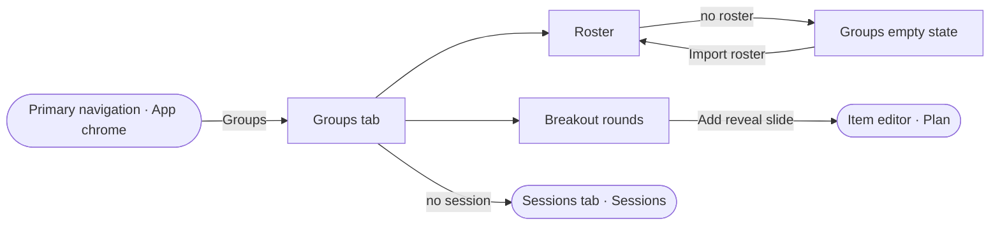

### `groups.tab` Groups tab

- **Root:** `data-surface`
- **Reach:** the Groups tab
- **Holds:**
  - the header with "n of m present"
  - the roster (left)
  - the breakout rounds (right)
- **States:**
  - no session picked: "Pick a session in the Sessions tab first." with a Sessions action
  - an error with Retry
- **Phone:** the roster stacks above the rounds
- **Desktop:** a split pane from 1100px
- **Leads to:**
  - [Roster](#groupsroster-roster)
  - [Breakout rounds](#groupsrooms-breakout-rounds)
  - [Sessions tab](#sessionstab-sessions-tab) (no session)

### `groups.roster` Roster

- **Root:** `data-surface`
- **Reach:** inside the Groups tab
- **Holds:**
  - Import roster and a Filter participants field
  - one row per person: a presence switch, the name, role · country, and "no email" when there is none
- **Does:**
  - Import roster picks an .xlsx with a name column on this PC
  - a switch marks the person present or absent and the rounds go stale until shuffled again
  - the filter matches name, role, company and country
- **States:**
  - no roster: "No roster yet. Import an .xlsx with a name column …" with an Import action
  - no match: "Nobody matches the filter."
  - an absent person is dimmed
- **Leads to:** [Groups empty state](#groupsempty-groups-empty-state) (no roster)

### `groups.empty` Groups empty state

- **Root:** none — a state of `groups.roster`, drawn inside the roster card
- **Reach:**
  - a session with no roster yet
  - no session picked (the card then points at the Sessions tab)
- **Holds:**
  - "No roster yet. Import an .xlsx with a name column (role, company, country, present and email are optional)." with Import roster
  - the rounds pane then shows only its title
- **Leads to:** [Roster](#groupsroster-roster) (Import roster)

### `groups.rooms` Breakout rounds

- **Root:** `data-surface`
- **Reach:** inside the Groups tab
- **Holds:**
  - "Breakout rounds" with when it was shuffled
  - a Round control: Pairs · Groups of 4 · A · Groups of 4 · B
  - a banner: the rooms and a note (pairs are random, round A keeps pairs together, round B names how many share a room with their round-A group), or a warning that presence changed since the shuffle
  - a card per room with its people
  - Shuffle again · Copy rooms for Zoom · Export Zoom pre-assign CSV · Add reveal slide
- **Does:**
  - Copy rooms puts the round's text on the clipboard to paste while assigning Zoom rooms
  - Export downloads the pre-assign CSV
  - Add reveal slide stages a "Who are you with?" item in the Plan tab, not saved yet
- **States:**
  - not shuffled: "n present. Shuffle to make pairs and two rounds of four with as few repeats as possible." with a Shuffle action
  - the CSV is disabled, and says whose email is missing, when anyone present has none
- **Leads to:** [Item editor](#planeditor-item-editor) (Add reveal slide)

## Results

Every captured activity and quiz game in the order it happened, and the session's exports.

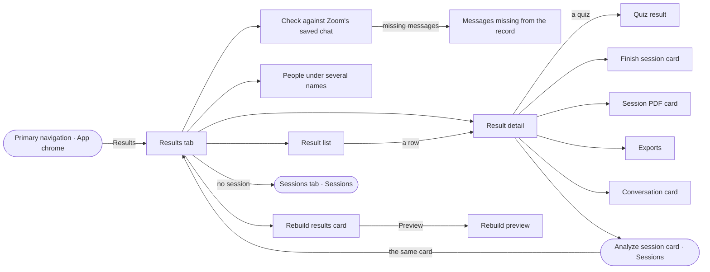

### `results.tab` Results tab

- **Root:** `data-surface`
- **Reach:** the Results tab
- **Holds:**
  - the header with the session's title and date
  - the check against Zoom's saved chat
  - People under several names
  - the activity list
  - Rebuild results
  - the selected result and the session's exports (right)
- **States:**
  - no session picked: "Pick a session in the Sessions tab first." with a Sessions action
  - an error with Retry
- **Phone:** the list stacks above the detail; choosing a result scrolls the detail into view
- **Desktop:** a split pane from 1100px
- **Leads to:**
  - [Check against Zoom's saved chat](#resultsreconcile-check-against-zooms-saved-chat)
  - [People under several names](#resultspeople-people-under-several-names)
  - [Result list](#resultslist-result-list)
  - [Rebuild results card](#resultsrebuild-rebuild-results-card)
  - [Result detail](#resultsdetail-result-detail)
  - [Sessions tab](#sessionstab-sessions-tab) (no session)

### `results.reconcile` Check against Zoom's saved chat

- **Root:** `data-surface`
- **Reach:** inside the Results tab, once the session went live
- **Holds:**
  - before a check: a card with Choose file
  - after one: a banner "n of m messages matched" (green) or with how many are missing (warn), and Check again
  - a "Messages that differ" fold listing Missing and Only-in-the-app messages
  - notes: reactions not counted, simulated left out
- **Does:** Choose file picks Zoom's saved chat on this PC and compares it with the app's record
- **States:** nothing is shown for a session that never went live
- **Leads to:** [Messages missing from the record](#resultsreconcile-warning-messages-missing-from-the-record) (missing messages)

### `results.reconcile-warning` Messages missing from the record

- **Root:** none — a state of `results.reconcile`
- **Reach:** a check that found messages Zoom saved and the app did not
- **Holds:** the warn banner and the "Messages that differ" fold, folded until opened

### `results.people` People under several names

- **Root:** `data-surface`
- **Reach:** inside the Results tab, when names look alike or were merged
- **Holds:**
  - a fold with "n suggested · n merged"
  - a row per Suggested group with Merge, a row per Merged group with Undo
  - Merge by hand: two name selects and Merge
- **Does:** nothing merges on its own; a merge is saved as aliases.yaml in the session folder
- **States:**
  - the fold opens by itself while there are suggestions
  - hidden when there is nothing to merge

### `results.list` Result list

- **Root:** `data-surface`
- **Reach:** inside the Results tab
- **Holds:** each captured activity and quiz game in the order it happened: a number (a crown for a quiz), the title and a summary
- **Does:** a row selects it and shows its detail
- **States:**
  - no capture yet: "No activity was captured in this session yet. Press Space on an activity during the session to capture answers."
  - before the session ran: "Results appear after a live session."
- **Leads to:** [Result detail](#resultsdetail-result-detail) (a row)

### `results.detail` Result detail

- **Root:** `data-surface`
- **Reach:**
  - a result list row
  - a live tile in the PDF strip
- **Holds:**
  - for an activity: its title and counts, the visual exactly as the stage showed it at the stop, the top items and every answer with the person's name
  - for a quiz: its podium, leaderboard and each question's distribution
  - Finish session, the Session PDF strip, Export session PDF, Excel report and the Open links
  - the Conversation card and the Analyze session card
- **States:**
  - a capture with no saved image says the answers below are complete
  - a hidden or excluded answer is dimmed with a chip
- **Leads to:**
  - [Quiz result](#resultsquiz-quiz-result) (a quiz)
  - [Finish session card](#resultswrap-up-finish-session-card)
  - [Session PDF card](#resultspdf-session-pdf-card)
  - [Exports](#resultsexports-exports)
  - [Conversation card](#resultsconversation-conversation-card)
  - [Analyze session card](#sessionsanalyze-analyze-session-card)

### `results.quiz` Quiz result

- **Root:** none — a rendering of `results.detail` for a quiz game
- **Reach:** a crown row in the result list
- **Holds:**
  - Podium and Leaderboard cards (rank, name, source chip, correct of asked, average time, score)
  - one card per question with a bar per answer, the correct one marked, and how many players answered
- **States:** nobody played: "Nobody played." and "No players."

### `results.wrap-up` Finish session card

- **Root:** `data-surface`
- **Reach:** inside the result detail, once something was captured
- **Holds:** "Finish session" with a status line and a Finish session button
- **Does:** rebuilds the results when the rules changed, exports the PDFs and the Excel report, then starts the analysis, and reports each step
- **States:**
  - running: the button reads "Finishing…"
  - the last run's line is kept across the redraw

### `results.pdf` Session PDF card

- **Root:** `data-surface`
- **Reach:** inside the result detail
- **Holds:**
  - "Session PDF" with slides + live results, when it was exported and its page count
  - a strip of tiles: a thumbnail per slide, a tile per live result, an Answers appendix
- **Does:** a live tile selects that result

### `results.exports` Exports

- **Root:** `data-surface`
- **Reach:** inside the result detail
- **Holds:**
  - Export session PDF and Excel report
  - Open links for each file that exists: full PDF, share PDF, participants' PDF, Excel report
- **Does:** the files stay in the session folder's exports/; the links open them in a new tab (inline, never a download) for a device that cannot reach that folder
- **States:**
  - Excel report is disabled with nothing captured
  - a button reads "Exporting…" while it runs

### `results.conversation` Conversation card

- **Root:** `data-surface`
- **Reach:** inside the result detail, for a session the copilot ran in or whose consent was confirmed
- **Holds:**
  - a fold with the transcript's size
  - a Transcript control when two transcripts exist (the recorder's and the live one)
  - the transcript under the item each line belongs to, with the hints the copilot gave
  - Recorder tracks: the episode folder, Transcribe, Summarise again and the run's state
  - Summary of the call
- **Does:** Transcribe runs the after-call transcription through the hub and polls while it runs
- **States:**
  - a session the copilot never ran in, with no consent, shows no card
  - an error with Retry; the recorder section is extra, so the conversation still shows when its state cannot be read

### `results.rebuild` Rebuild results card

- **Root:** `data-surface`
- **Reach:** inside the Results tab, once something was frozen
- **Holds:**
  - "Rebuild results" with Preview and Undo last rebuild
  - after Preview: what would change and Rebuild n activities, Cancel
- **Does:** Preview writes nothing; Rebuild backs up first; Undo restores the backup
- **States:**
  - idle, loading, preview, busy and error
  - a session that is live cannot be rebuilt: the server says so
  - Rebuild is disabled when nothing would change
- **Leads to:** [Rebuild preview](#resultsrebuild-preview-rebuild-preview) (Preview)

### `results.rebuild-preview` Rebuild preview

- **Root:** none — a step of `results.rebuild`
- **Reach:** Preview
- **Holds:** how many captured activities would change and what each change is

## Settings

A full page over the current tab, opened by the header gear: five sections of inset groups; a row that needs room opens a sheet.

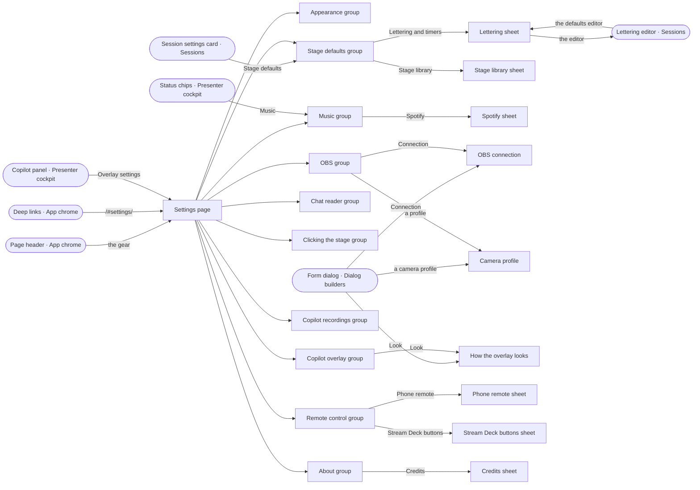

### `settings.pane` Settings page

- **Root:** `data-surface`
- **Reach:**
  - the header gear on any tab
  - `/#settings` and `/#settings/<section>`
  - the presenter's music chip (`/#settings/music`) and the Copilot panel's Overlay settings link (`/#settings/live`)
- **Holds:**
  - a sticky header with the title "Settings" and a close cross
  - five sections: Appearance · Stage defaults · Music · Live tools · About
- **Does:**
  - the cross or Esc closes it; the tab behind keeps its place
  - a deep link scrolls to its section under the sticky header
- **States:** the settings could not be read: a toast says why and the page stays empty
- **Phone:** full screen
- **Desktop:** a page with the 772px measure
- **Why:** Settings is a full page over the current tab (a modal `<dialog>`), not a tab: it is one tap from every tab and leaves the tab where it was
- **Leads to:**
  - [Appearance group](#settingsappearance-appearance-group)
  - [Stage defaults group](#settingsstage-defaults-stage-defaults-group)
  - [Music group](#settingsmusic-music-group)
  - [OBS group](#settingsobs-obs-group)
  - [Chat reader group](#settingsreader-chat-reader-group)
  - [Clicking the stage group](#settingsstage-click-clicking-the-stage-group)
  - [Copilot overlay group](#settingsoverlay-copilot-overlay-group)
  - [Copilot recordings group](#settingsrecording-retention-copilot-recordings-group)
  - [Remote control group](#settingsremote-control-remote-control-group)
  - [About group](#settingsabout-about-group)

### `settings.appearance` Appearance group

- **Root:** none — a group built by the vendored settings-group inside `settings.pane`
- **Reach:** Settings → Appearance
- **Holds:**
  - Light and dark: System · Light · Dark
  - Text size: Small · Default · Large
- **Does:**
  - light and dark covers the app, the presenter and the phone remote on every device at once; System follows each device
  - text size is for this device only
- **Why:** the stage keeps the session's look; only the cockpit and the app follow the appearance

### `settings.stage-defaults` Stage defaults group

- **Root:** none — a group built by the vendored settings-group inside `settings.pane`
- **Reach:** Settings → Stage defaults
- **Holds:**
  - Colour set (a select)
  - Lettering and timers (opens the lettering sheet)
  - Stage library (opens the library sheet)
- **Does:** a new session copies these; an existing session keeps its own
- **Leads to:**
  - [Lettering sheet](#settingslettering-lettering-sheet) (Lettering and timers)
  - [Stage library sheet](#settingslibrary-stage-library-sheet) (Stage library)

### `settings.lettering` Lettering sheet

- **Root:** `data-surface`
- **Reach:** Settings → Stage defaults → Lettering and timers
- **Holds:** a note, then the lettering editor on a sample of its own: Title font, Text font, Each kind of text, Timer colours
- **Does:** each change saves as the default new sessions start from; the row's value redraws behind the sheet
- **Phone:** a bottom sheet that fits the screen and scrolls its body; Done stays pinned
- **Desktop:** a wide dialog
- **Leads to:** [Lettering editor](#sessionsstage-font-lettering-editor) (the editor)

### `settings.library` Stage library sheet

- **Root:** `data-surface`
- **Reach:** Settings → Stage defaults → Stage library
- **Holds:**
  - the library's fonts and colour sets, one row each
  - the folder the files live in (next to the sessions, never in the app's folder)
  - Add font… and Add colour set…
- **Does:** each Add opens the native file picker and copies the file into the library
- **States:** empty: "Nothing here yet. Add a font file or a colour set to offer it to every session."

### `settings.music` Music group

- **Root:** none — a group built by the vendored settings-group inside `settings.pane`
- **Reach:** Settings → Music
- **Holds:**
  - Spotify (its state as the value: Connected, Not set up, Login expired, Desktop app not open, Not playing, Command refused, Premium needed, Checking…)
  - Fade in and Fade out, in seconds
- **Does:** the fades are what an item's music starts with when it is switched on in the Plan tab
- **Leads to:** [Spotify sheet](#settingsspotify-spotify-sheet) (Spotify)

### `settings.spotify` Spotify sheet

- **Root:** `data-surface`
- **Reach:** Settings → Music → Spotify
- **Holds:**
  - Account, Plays on and Last check
  - a line while the browser login is open (the sheet updates by itself), or why it failed
  - a note when the client id is not set up
  - Connect Spotify (Reconnect when logged in) and Check now
- **Does:**
  - Connect Spotify opens Spotify's login in the browser; the login is saved on this PC only
  - Check now asks Spotify again
- **States:**
  - Connect is disabled while a login is open or the client id is missing
  - music plays on the Spotify desktop app of this PC, never a web player

### `settings.obs` OBS group

- **Root:** none — a group built by the vendored settings-group inside `settings.pane`
- **Reach:** Settings → Live tools → OBS
- **Holds:**
  - Connection (the state as the value: OBS connected, Connecting…, OBS not reachable, Switching off)
  - one row per camera profile with its scene
  - Test connection
- **Does:** each plan item has a profile; the app switches OBS to that profile's scene when the item goes on stage
- **Leads to:**
  - [OBS connection](#settingsobs-connection-obs-connection) (Connection)
  - [Camera profile](#settingsobs-profile-camera-profile) (a profile)

### `settings.obs-connection` OBS connection

- **Root:** none — an instance of `dialog.form`
- **Reach:** OBS group → Connection
- **Holds:** Scene switching (On or Off), Host, Port, Password (empty keeps the current one)

### `settings.obs-profile` Camera profile

- **Root:** none — an instance of `dialog.form`
- **Reach:** OBS group → a profile row
- **Holds:**
  - OBS scene (a select of OBS's scenes, or a text field when OBS is not connected)
  - Camera zone left, top, right, bottom as fractions of the canvas

### `settings.reader` Chat reader group

- **Root:** none — a group built by the vendored settings-group inside `settings.pane`
- **Reach:** Settings → Live tools → Chat reader
- **Holds:** "<Zoom, Teams or Meet> chat reader": a switch, "Starts when a session goes live"
- **Does:** the source is chosen on the presenter, under the chat

### `settings.stage-click` Clicking the stage group

- **Root:** none — a group built by the vendored settings-group inside `settings.pane`
- **Reach:** Settings → Live tools → Clicking the stage
- **Holds:** Next item on click · Camera layout on click (two switches)
- **Why:** going to the next item on a click is off by default, so a stray click cannot move the presentation on

### `settings.overlay` Copilot overlay group

- **Root:** none — a group built by the vendored settings-group inside `settings.pane`
- **Reach:** Settings → Live tools → Copilot overlay
- **Holds:**
  - Show hints on an overlay (a switch)
  - Screen · Position · Shows (the hint itself, or only a cue)
  - Look (opens a form)
  - Show a sample
- **Does:** every save moves an open overlay at once and puts a sample there
- **States:**
  - loading, and the error when the settings cannot be read
  - a toast says when the overlay is saved but not running
- **Leads to:** [How the overlay looks](#settingsoverlay-look-how-the-overlay-looks) (Look)

### `settings.overlay-look` How the overlay looks

- **Root:** none — an instance of `dialog.form`
- **Reach:** Copilot overlay → Look
- **Holds:** Shape, Width, Font, Text size, Text colour, Background, Background opacity, Distance from the edge, Shown for

### `settings.recording-retention` Copilot recordings group

- **Root:** none — a group built by the vendored settings-group inside `settings.pane`
- **Reach:** Settings → Live tools → Copilot recordings
- **Holds:** Retention: Keep recordings · Remove after 7 / 14 / 30 / 90 / 365 days
- **Does:** applies to the audio files in each session's Copilot folder when the session is opened; transcripts and hints are kept
- **States:** loading, and the error when the settings cannot be read

### `settings.remote-control` Remote control group

- **Root:** none — a group built by the vendored settings-group inside `settings.pane`
- **Reach:** Settings → Live tools → Remote control
- **Holds:**
  - Phone remote (on, off, needs HTTPS or unavailable as the value)
  - Stream Deck buttons (how many)
- **Leads to:**
  - [Phone remote sheet](#settingsremote-phone-remote-sheet) (Phone remote)
  - [Stream Deck buttons sheet](#settingsdeck-stream-deck-buttons-sheet) (Stream Deck buttons)

### `settings.remote` Phone remote sheet

- **Root:** `data-surface`
- **Reach:** Remote control → Phone remote
- **Holds:**
  - a note on pairing
  - the pairing link with its token hidden
  - Copy the link · New link (unpairs phones) · Turn off, or Make the phone link while off
- **States:**
  - the server only accepts local connections: says to set host to 0.0.0.0 and restart the tray
  - HTTPS is not set up: says to run the certificate script and restart the tray
- **Why:** other devices never get in without the link; this PC never needs it

### `settings.deck` Stream Deck buttons sheet

- **Root:** `data-surface`
- **Reach:** Remote control → Stream Deck buttons
- **Holds:**
  - a note on the POST pattern
  - one row per action the deck can call: its label, its path and Copy
- **Does:** Copy puts the full URL on the clipboard
- **States:** loading, and the error text when the actions cannot be read

### `settings.about` About group

- **Root:** none — a group built by the vendored settings-group inside `settings.pane`
- **Reach:** Settings → About
- **Holds:**
  - Build (the build line, "…" while reading, "unknown" when it failed)
  - Credits (how many sources)
- **Leads to:** [Credits sheet](#settingscredits-credits-sheet) (Credits)

### `settings.credits` Credits sheet

- **Root:** `data-surface`
- **Reach:** About → Credits
- **Holds:** GeoNames · Natural Earth · world-atlas · Unicode CLDR · Patrick Hand · Lucide, each a link and what it is used for

## Presenter cockpit

`/presenter`, the live cockpit on the second monitor.

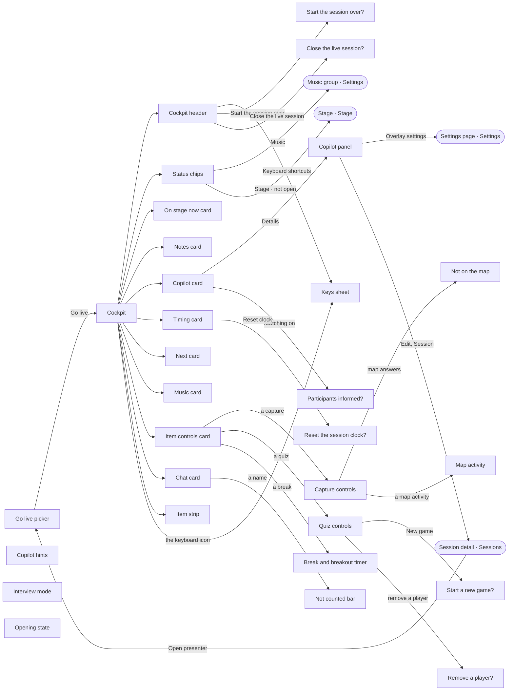

### `presenter.picker` Go live picker

- **Root:** `data-surface`
- **Reach:** `/presenter` with no session live
- **Holds:**
  - "Go live" and a line saying the stage follows the session
  - a row per session with Go live
  - a link back to the app
- **Does:** Go live activates the session; the cockpit replaces the picker
- **States:**
  - loading, "No sessions yet — create one in the app."
  - an error toast when the ledger cannot be read
- **Leads to:** [Cockpit](#presentercockpit-cockpit) (Go live)

### `presenter.cockpit` Cockpit

- **Root:** `data-surface`
- **Reach:**
  - `/presenter` with a session live
  - Open presenter on the open session
- **Holds:**
  - the header, the chips, then four columns: what is on stage, its notes, Copilot and the clocks · what comes next and the music · the item's controls · the chat
  - the thumbnail strip
  - the keys sheet
- **States:**
  - narrower than four columns the cards stack in their own order
  - the server is unreachable: a red "Server · reconnecting" chip
- **Why:** the facilitator reads the whole state without a click; every action is one tap or one key
- **Leads to:**
  - [Cockpit header](#presenterheader-cockpit-header)
  - [Status chips](#presenterchips-status-chips)
  - [On stage now card](#presenternow-on-stage-now-card)
  - [Notes card](#presenternotes-notes-card)
  - [Copilot card](#presentercopilot-copilot-card)
  - [Timing card](#presentertiming-timing-card)
  - [Next card](#presenternext-next-card)
  - [Music card](#presentermusic-music-card)
  - [Item controls card](#presenteritem-item-controls-card)
  - [Chat card](#presenterchat-chat-card)
  - [Item strip](#presenterstrip-item-strip)
  - [Keys sheet](#presenterkeys-keys-sheet) (the keyboard icon)

### `presenter.header` Cockpit header

- **Root:** `data-surface`
- **Reach:** the top of the cockpit
- **Holds:**
  - the session's title and a sub-line (Slide n of m, hidden, the item's title)
  - the chips
  - Keyboard shortcuts · Blackout · Toggle theme · Start the session over · Close the live session
- **Does:**
  - Blackout blanks the stage (and shows a flag on the On stage card)
  - the theme toggle changes every screen at once
- **Leads to:**
  - [Keys sheet](#presenterkeys-keys-sheet) (Keyboard shortcuts)
  - [Start the session over?](#presenterconfirm-reset-start-the-session-over) (Start the session over)
  - [Close the live session?](#presenterconfirm-close-close-the-live-session) (Close the live session)

### `presenter.chips` Status chips

- **Root:** `data-surface`
- **Reach:** the cockpit header
- **Holds:**
  - the chat reader (reading, simulating, starting, pop out the chat, no answer, error, off)
  - OBS (connected with its profile, a warning, off, connecting, not reachable)
  - Stage (the window count or size, or not open)
  - the last Stream Deck or button press
  - Music (opens Settings → Music)
  - Quiz (the PIN and players, or why players cannot join)
  - Counting your messages
  - Copilot
- **Does:** an off reader's chip starts it, an unreachable OBS chip tests the connection, a missing stage's chip opens the stage window
- **States:** each chip carries its detail as a tooltip; a failure outranks a warning
- **Leads to:**
  - [Music group](#settingsmusic-music-group) (Music)
  - [Stage](#stagelive-stage) (Stage · not open)

### `presenter.keys` Keys sheet

- **Root:** `data-surface`
- **Reach:** the keyboard icon in the header
- **Holds:** → or PageDown next, ← or PageUp previous, B blackout, T timer start or pause, M timer plus one minute, Space capture (else the timer), Home and End first and last item
- **Does:** the icon toggles it; the same keys work on the stage window

### `presenter.now` On stage now card

- **Root:** `data-surface`
- **Reach:** the cockpit's first column
- **Holds:**
  - a live preview of what Zoom sees, with the camera guide
  - a blackout flag while the stage is black
- **Does:** a click on the preview goes on to the next item

### `presenter.notes` Notes card

- **Root:** `data-surface`
- **Reach:** the cockpit's first column
- **Holds:**
  - the item's notes (from the plan, or the slide's PowerPoint notes, or an activity's question)
  - Copy prompt, for an activity with a chat prompt
- **States:** "No speaker notes on this slide." or "No notes — add them in the Plan tab."

### `presenter.copilot` Copilot card

- **Root:** `data-surface`
- **Reach:** the cockpit's first column
- **Holds:**
  - switches: Copilot, Local only, Interview (with the interviewee's name field while on)
  - a Recording chip and per-channel failures
  - the hints for the item on stage, newest first
  - the panel
- **Does:**
  - switching Copilot on for a session whose consent was not recorded asks first
  - Interview saves the mode and asks for the interviewee's name
- **States:**
  - off: a sentence on what it records and to tell the participants
  - listening, with the line count
  - a hint is labelled Test when it came from the test
- **Leads to:**
  - [Copilot panel](#presentercopilot-panel-copilot-panel) (Details)
  - [Participants informed?](#presenterconfirm-copilot-consent-participants-informed) (switching on)

### `presenter.copilot-hints` Copilot hints

- **Root:** none — a state of `presenter.copilot`
- **Reach:** Copilot on, with a hint for the item on stage
- **Holds:** each hint with its kind (and Test), newest first; in the overlay's cue mode this is where the flashing icon sends the eye

### `presenter.copilot-interview` Interview mode

- **Root:** none — a state of `presenter.copilot`
- **Reach:** the Interview switch
- **Holds:** the interviewee's name field; hints are about the interviewee

### `presenter.copilot-panel` Copilot panel

- **Root:** `data-surface`
- **Reach:** inside the Copilot card
- **Holds:**
  - a strip: each channel's live level (Your mic, The call), how the latest check ended, and Details
  - Details: Status per channel, What it reads (the notes with Edit, the playbook with Open or Session), Where hints show with Show a sample, Overlay settings and Test copilot, and "How the copilot works"
- **Does:**
  - Test copilot asks for one hint on what was just said and labels it a test
  - while Copilot is on the levels poll once a second
- **States:** Test copilot is disabled while Copilot is off
- **Phone:** Details opens inline under the strip; the cockpit stacks its cards in one column below 1100px
- **Desktop:** from 1100px with a mouse, Details is a floating card laid exactly over the Next and Music cards (the second column) with a shadow, until the button folds it
- **Leads to:**
  - [Settings page](#settingspane-settings-page) (Overlay settings)
  - [Session detail](#sessionsdetail-session-detail) (Edit, Session)

### `presenter.confirm-copilot-consent` Participants informed?

- **Root:** none — an instance of `dialog.confirm`
- **Reach:** switching Copilot on for a session without recorded consent
- **Holds:** says Copilot records the mic and the call, that staying in the call is not consent, and that the app records the confirmation
- **Why:** the server refuses to record without it, so a Stream Deck press cannot skip the question

### `presenter.timing` Timing card

- **Root:** `data-surface`
- **Reach:** the cockpit's first column
- **Holds:**
  - before the clock starts: 00:00 of the planned length and Start the session clock
  - while it runs: the elapsed time, Reset clock, the section's name, planned minutes and time left or over, a progress bar, the next break and a drift chip
- **Leads to:** [Reset the session clock?](#presenterconfirm-clock-reset-reset-the-session-clock) (Reset clock)

### `presenter.next` Next card

- **Root:** `data-surface`
- **Reach:** the cockpit's second column
- **Holds:**
  - a preview of the next item and a caption
  - Then: the next four visible items with their kinds
- **States:** "end of the session", "Nothing after this."

### `presenter.music` Music card

- **Root:** `data-surface`
- **Reach:** the cockpit's second column, when the session has music, a Spotify link or music engaged
- **Holds:**
  - what is playing and its volume
  - a track select, a Spotify link field with Play link
  - Play, Pause or Resume · Previous track · Next track · Stop · Fade out
  - a hint saying who owns the music
- **States:**
  - previous and next are only for a Spotify track; a file is one track
  - an error shows the music service's detail

### `presenter.item` Item controls card

- **Root:** `data-surface`
- **Reach:** the cockpit's third column; titled Timer, Capture or Quiz by the item on stage
- **Holds:**
  - a timer: the clock and its state, Start timer / Pause / Resume, +1 min, Reset
  - a capture: its status, counts, Start / Stop / Reopen capture
  - a quiz: see Quiz controls
  - Show names on stage (an activity) and Count my own messages (a capture)
- **Does:** Space starts or stops a capture, else the timer; T and M work the timer
- **States:** "No timer on this item. Timers are decided item by item in the Plan tab."
- **Leads to:**
  - [Capture controls](#presentercapture-capture-controls) (a capture)
  - [Quiz controls](#presenterquiz-live-quiz-controls) (a quiz)
  - [Break and breakout timer](#presenterbreak-timer-break-and-breakout-timer) (a break)

### `presenter.capture` Capture controls

- **Root:** none — a state of `presenter.item`
- **Reach:** an activity that collects chat answers
- **Holds:**
  - a status dot and "Not started — answers are not counted yet", "Capturing answers" or "Stopped — the result is frozen"
  - the answer, person, hidden and excluded counts
  - a note when the word cloud has no room for every entry
  - Start capture, Stop capture or Reopen capture with the Space key
  - Not on the map, for a map activity (see below)
- **Leads to:**
  - [Not on the map](#presenterunplaced-not-on-the-map) (map answers)
  - [Map activity](#presentermap-map-activity) (a map activity)

### `presenter.unplaced` Not on the map

- **Root:** `data-surface`
- **Reach:** a map activity with answers the gazetteer could not place
- **Holds:** "Not on the map · n", and per answer: up to three suggested places and a field to type the place
- **Does:** a suggestion or Enter places the answer on the map
- **States:** "No close match — type the place below."

### `presenter.map` Map activity

- **Root:** none — a state of `presenter.item` for a map item
- **Reach:** a map activity on stage
- **Holds:** the capture controls and the unplaced list

### `presenter.break-timer` Break and breakout timer

- **Root:** none — a state of `presenter.item` for a break or breakout
- **Reach:** a break or breakout with a timer on stage
- **Holds:** the timer controls; the clock also shows on the stage

### `presenter.quiz-live` Quiz controls

- **Root:** none — a state of `presenter.item` for a quiz item
- **Reach:** a quiz lobby, question or podium on stage
- **Holds:**
  - the phase and the time left
  - player counts, sound chip (n of m files, no audio output, unknown), the join PIN and link with Copy link, the public-link reachability chip with Check
  - Next (named for the step: Start the first question, Reveal the answer, Show the leaderboard, Next question, On to the podium, Show 3rd/2nd/1st), Lock answers, New game (lobby only)
  - Count my own chat answers
  - Players, each with a remove button
- **Does:** Next steps the phases; Lock closes the answers early
- **States:**
  - "Nobody has joined yet." in the lobby, "No players." after
  - no join PIN yet, or the public link is not configured
- **Leads to:**
  - [Start a new game?](#presenterconfirm-quiz-new-start-a-new-game) (New game)
  - [Remove a player?](#presenterconfirm-quiz-kick-remove-a-player) (remove a player)

### `presenter.confirm-quiz-new` Start a new game?

- **Root:** none — an instance of `dialog.confirm`
- **Reach:** New game in the quiz lobby
- **Holds:** says the quiz starts over with no players and the game so far is kept in Results

### `presenter.confirm-quiz-kick` Remove a player?

- **Root:** none — an instance of `dialog.confirm`
- **Reach:** the remove button on a player
- **Holds:** names the player; they leave the game and the leaderboard, and their phone says so; it cannot be undone

### `presenter.chat` Chat card

- **Root:** `data-surface`
- **Reach:** the cockpit's fourth column
- **Holds:**
  - the latest 400 messages, each with the sender, the time and the text, marked as counted, hidden or excluded
  - a "Not counted" bar of excluded senders
  - a hint for the reader's state
  - a source control: Zoom · Teams · Meet
  - Start reader or Stop reader, and Simulate answers
- **Does:**
  - a click on a message hides it from the activity, again to count it back
  - a click on a name stops counting everything that sender writes
  - Simulate answers sends sample answers through the real chat pipeline
- **States:**
  - "updated n s ago" while the reader reads
  - no messages: the hint says to start the reader or simulate answers
  - your own messages are marked and never counted
- **Leads to:** [Not counted bar](#presenterexcluded-not-counted-bar) (a name)

### `presenter.excluded` Not counted bar

- **Root:** `data-surface`
- **Reach:** above the chat list, once a sender is excluded
- **Holds:** one chip per excluded sender with a cross
- **Does:** a chip counts that sender again

### `presenter.strip` Item strip

- **Root:** `data-surface`
- **Reach:** the foot of the cockpit
- **Holds:** Previous · a thumbnail per item, numbered, the current one highlighted · Next
- **Does:** a thumbnail jumps to that item; the strip scrolls to keep the current one centred
- **States:** a hidden item is marked with an eye-off

### `presenter.confirm-reset` Start the session over?

- **Root:** none — an instance of `dialog.confirm`
- **Reach:** the header's reset button
- **Holds:** says it goes back to the first item with no clocks, timers, captures or chat, and the run so far is kept in the session folder

### `presenter.confirm-close` Close the live session?

- **Root:** none — an instance of `dialog.confirm`
- **Reach:** the header's close button
- **Holds:** says the stage goes blank and position, clocks and timers come back when you go live again

### `presenter.confirm-clock-reset` Reset the session clock?

- **Root:** none — an instance of `dialog.confirm`
- **Reach:** the Timing card's Reset clock
- **Holds:** says the session and section clocks go back to zero

### `presenter.opening` Opening state

- **Root:** none — the cockpit on the first item before anything has run
- **Reach:** going live
- **Holds:** the first slide on stage, "Start the session clock", a disabled Previous

## Stage

`/stage`, the window OBS captures: the session theme, never the fleet design.

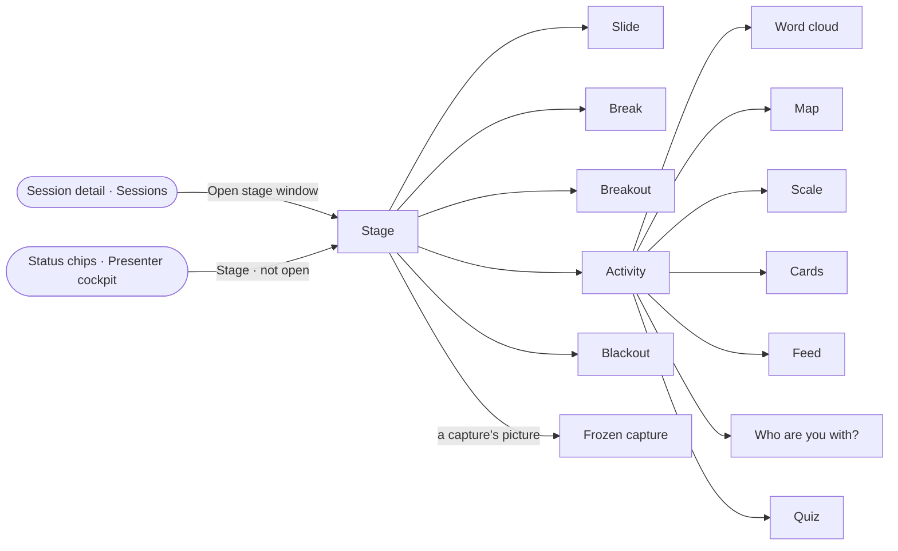

### `stage.live` Stage

- **Root:** `data-surface`
- **Reach:** `/stage`, opened from Open stage window or the presenter's Stage chip, captured by OBS
- **Holds:**
  - the current item drawn on a canvas that scales to the window, centred in a letterbox of the theme's own background
  - the item's camera zone left clear
  - a blackout layer
- **Does:**
  - the keys and a clicker work (next, previous, first, last, blackout, timer)
  - a click does what Settings → Clicking the stage says, a double-click toggles full screen
  - the pointer hides after two quiet seconds
- **States:**
  - the session's theme and lettering, never the fleet design
  - no live session: a blank canvas in the slides' light grey, so the stage never shows a half-loaded frame
- **Why:** the stage is a rendering, not a UI: its only controls are keys and clicks, so Zoom never sees a button
- **Leads to:**
  - [Slide](#stageslide-slide)
  - [Break](#stagebreak-break)
  - [Breakout](#stagebreakout-breakout)
  - [Activity](#stageactivity-activity)
  - [Blackout](#stageblackout-blackout)
  - [Frozen capture](#stagefrozen-frozen-capture) (a capture's picture)

### `stage.slide` Slide

- **Root:** none — a rendering inside `stage.live`
- **Reach:** a slide item on stage
- **Holds:**
  - the slide's picture, or its background with its text boxes drawn in the session's lettering
  - a timer pill when the item has one

### `stage.break` Break

- **Root:** none — a rendering inside `stage.live`
- **Reach:** a break item on stage
- **Holds:** the title in the title font and, with a timer, a big clock in the colour of its state

### `stage.breakout` Breakout

- **Root:** none — a rendering inside `stage.live`
- **Reach:** a breakout item on stage
- **Holds:** the title, a line saying which round is in the rooms and how many, and the clock

### `stage.activity` Activity

- **Root:** none — a rendering inside `stage.live`, one plug-in per type
- **Reach:** an activity item on stage
- **Holds:** the question, a body drawn by the activity's plug-in, a footer with the chat hint, the answer count and the timer pill
- **Leads to:**
  - [Word cloud](#stageword-cloud-word-cloud)
  - [Map](#stagemap-map)
  - [Scale](#stagescale-scale)
  - [Cards](#stagecards-cards)
  - [Feed](#stagefeed-feed)
  - [Who are you with?](#stagegroups-reveal-who-are-you-with)
  - [Quiz](#stagequiz-quiz)

### `stage.word-cloud` Word cloud

- **Root:** none — an activity body inside `stage.activity`
- **Reach:** a Word cloud item
- **Holds:** the most frequent words biggest on a spiral from the centre, each keeping its colour
- **States:** an entry with no room is counted as "+n more" and the presenter hears how many

### `stage.map` Map

- **Root:** none — an activity body inside `stage.activity`
- **Reach:** a Map item
- **Holds:** the world outline with a pin per placed answer, easing to fit the pins; optionally an inset and names

### `stage.scale` Scale

- **Root:** none — an activity body inside `stage.activity`
- **Reach:** a Scale item
- **Holds:** the average on top and one bar per value with its count, the leading bar highlighted

### `stage.cards` Cards

- **Root:** none — an activity body inside `stage.activity`
- **Reach:** a Cards item
- **Holds:** the latest answers as cards, optionally with the person's name; the oldest leaves when the grid is full

### `stage.feed` Feed

- **Root:** none — an activity body inside `stage.activity`
- **Reach:** a Feed item
- **Holds:** answers as bubbles, the newest first and largest; older ones shrink and fade

### `stage.groups-reveal` Who are you with?

- **Root:** none — an activity body inside `stage.activity`
- **Reach:** a Who are you with? item
- **Holds:** every breakout room of the chosen round as a numbered card, so each person finds their room

### `stage.quiz` Quiz

- **Root:** none — an activity body inside `stage.activity`, one renderer for the three quiz types
- **Reach:** a Quiz lobby, Quiz question or Quiz podium item
- **Holds:**
  - lobby: the QR code, the join link and PIN, the players popping in
  - question: the answers on coloured tiles with shapes and letters, a countdown, the answered count; then the reveal (a bar per answer, the correct one marked with a check and a label) and the leaderboard (top five)
  - podium: 3rd, then 2nd, then 1st
- **Why:** the correct answer is never shown by colour alone

### `stage.blackout` Blackout

- **Root:** none — a layer inside `stage.live`
- **Reach:** B on the stage or the presenter, the presenter's or remote's Blackout
- **Holds:** a black layer over the canvas; the presenter flags it

### `stage.frozen` Frozen capture

- **Root:** none — `/stage?freeze=<item>`, a rendering of `stage.live`
- **Reach:** the server's headless browser, writing a stopped capture's picture
- **Holds:** the stopped item rendered once from its frozen result, then marked ready
- **Why:** Results shows exactly what the audience saw at the stop, from this picture

## Phone remote

`/remote`, the cockpit's buttons on a phone, over Tailscale.

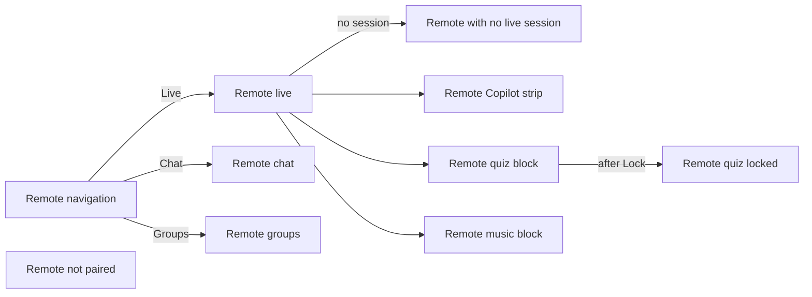

### `remote.nav` Remote navigation

- **Root:** `data-surface`
- **Reach:** every page of the remote
- **Holds:** Live · Chat · Groups
- **Does:** a tap switches the pane and remembers it; opening Groups reads the rooms
- **Leads to:**
  - [Remote live](#remotelive-remote-live) (Live)
  - [Remote chat](#remotechat-remote-chat) (Chat)
  - [Remote groups](#remotegroups-remote-groups) (Groups)

### `remote.live` Remote live

- **Root:** `data-surface`
- **Reach:** `/remote`, the Live tab
- **Holds:**
  - a header with the theme toggle and a sub-line (Slide n of m, capturing, blackout)
  - On stage: the preview, the title, the answer count and the item timer
  - Next, the session clock with its drift, and the section's time left
  - the Copilot strip
  - Start, Stop or Reopen capture
  - the quiz block
  - Previous and Next
  - Start or Pause the timer, +1 min, Blackout
  - the music block
- **Does:**
  - each button sends the same intent as the keyboard
  - the theme toggle changes every screen at once
- **States:**
  - "Connecting…" until the first snapshot
  - the capture, timer and music controls only show when the item has them
- **Leads to:**
  - [Remote Copilot strip](#remotecopilot-hints-remote-copilot-strip)
  - [Remote quiz block](#remotequiz-remote-quiz-block)
  - [Remote music block](#remotemusic-remote-music-block)
  - [Remote with no live session](#remoteidle-remote-with-no-live-session) (no session)

### `remote.idle` Remote with no live session

- **Root:** none — a state of `remote.live`
- **Reach:** `/remote` while no session is live
- **Holds:** "No session is live. Start it from the presenter on the PC." and "Not live" in the header

### `remote.unpaired` Remote not paired

- **Root:** none — a state of `remote.live`
- **Reach:** a device with no valid pairing link
- **Holds:** no tabs, "Not paired", and either "The phone remote is off" or "This phone is not paired yet" with the Settings path to fix it
- **Why:** other devices never get in without the link made in Settings on the PC

### `remote.copilot-hints` Remote Copilot strip

- **Root:** `data-surface`
- **Reach:** while Copilot is on
- **Holds:**
  - a header with "n hints" or "listening" and a chevron
  - the fresh hints for the item on stage, as the presenter shows them
- **Does:** a tap folds the strip; the choice is remembered on this phone
- **States:** folded shows only how many hints there are

### `remote.quiz` Remote quiz block

- **Root:** `data-surface`
- **Reach:** a quiz lobby, question or podium on stage
- **Holds:**
  - the phase (Quiz lobby, Answers open, Answers locked, Leaderboard, Podium) with the question number
  - the time left, the players, how many answered and the PIN
  - Lock answers
- **States:**
  - "Not in a game" or "Cannot be played"
  - Lock is disabled outside the question phase
- **Leads to:** [Remote quiz locked](#remotequiz-locked-remote-quiz-locked) (after Lock)

### `remote.quiz-locked` Remote quiz locked

- **Root:** none — a state of `remote.quiz`
- **Reach:** a question's answers locked or revealed
- **Holds:** "Answers locked" and a disabled Lock answers

### `remote.music` Remote music block

- **Root:** `data-surface`
- **Reach:** when the session has music
- **Holds:**
  - what is playing
  - Play, Pause or Resume music · Previous · Next · Stop music
  - a volume slider
- **States:**
  - previous and next are only for a Spotify track
  - an error shows the music service's detail

### `remote.chat` Remote chat

- **Root:** `data-surface`
- **Reach:** `/remote`, the Chat tab
- **Holds:**
  - a header with the reader's state
  - the latest 80 messages, newest first
  - a hint: tap a message to hide it from the activity, tap again to count it back
- **States:** "No messages yet."

### `remote.groups` Remote groups

- **Root:** `data-surface`
- **Reach:** `/remote`, the Groups tab
- **Holds:**
  - "Breakout rooms"
  - a Round control: Pairs · Groups of 4 · A · Groups of 4 · B
  - the rooms to read out, each with its people
- **States:**
  - "Rooms show here while a session is live."
  - "Not shuffled yet — shuffle in the Groups tab on the PC."
  - an error

## Quiz player

`/play` on the quiz's own public port: the participant's phone.

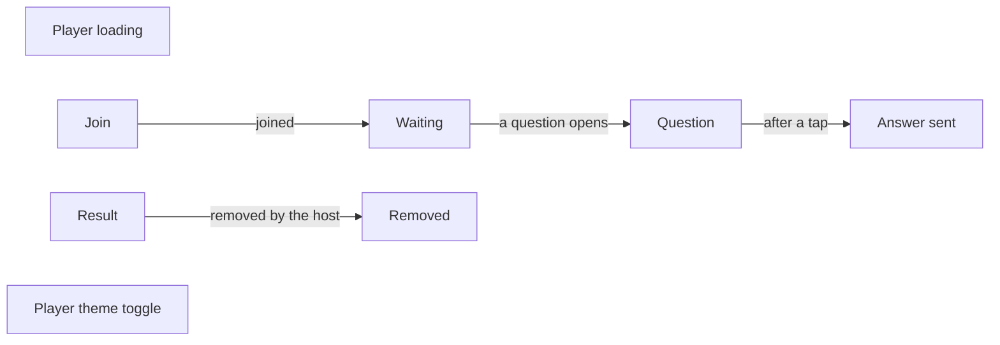

### `player.loading` Player loading

- **Root:** `data-surface`
- **Reach:** the quiz page while it waits for the server's ping
- **Holds:** "Loading…"; the first screen waits a moment so it opens in the game's language

### `player.join` Join

- **Root:** `data-surface`
- **Reach:** `/play` on the quiz's public port, with no game joined
- **Holds:**
  - a header with the connection state, the theme toggle
  - Game PIN and Nickname fields, an error line and Join
- **Does:** Join checks the PIN; the screen says in the game's language what went wrong (no game has that PIN, and so on)
- **States:** the connection chip reads Connecting… until it knows
- **Leads to:** [Waiting](#playerwait-waiting) (joined)

### `player.wait` Waiting

- **Root:** `data-surface`
- **Reach:** joined a lobby, or a phase with nothing to answer
- **Holds:** the player's name and "You're in! Watch the screen — the quiz starts soon." or "Watch the screen."
- **Leads to:** [Question](#playerquestion-question) (a question opens)

### `player.question` Question

- **Root:** `data-surface`
- **Reach:** a question's phase, while answers are open
- **Holds:**
  - the question number and a countdown
  - the question text
  - four answer tiles, each with a shape and a colour (triangle, diamond, circle, square), never colour alone
- **Does:** a tap sends the answer
- **Leads to:** [Answer sent](#playerlocked-answer-sent) (after a tap)

### `player.locked` Answer sent

- **Root:** `data-surface`
- **Reach:** after tapping an answer
- **Holds:**
  - the chosen shape
  - Sent, Sending… or Retrying, with "keep this open"
  - Too late or Not sent, with the reason in the player's language

### `player.result` Result

- **Root:** `data-surface`
- **Reach:** a question's reveal, the leaderboard and the podium
- **Holds:**
  - Correct, Not this time, Time's up or No answer, with the points gained and the standing
  - the right answer(s) after a miss
  - at the leaderboard and podium: the player's rank (a crown for first), score and streak
- **Leads to:** [Removed](#playerkicked-removed) (removed by the host)

### `player.kicked` Removed

- **Root:** `data-surface`
- **Reach:** the host removed the player
- **Holds:** "Removed" and "The host removed you from this game."

### `player.theme` Player theme toggle

- **Root:** none — a button in the header of every player screen
- **Reach:** the header of every player screen
- **Holds:** a sun or moon button
- **Does:** switches light and dark for this phone only (its own choice, else the OS setting)
- **Why:** the player shares nothing with the app: it has its own tokens and its own theme choice

## Link index

| From | Via | To |
|---|---|---|
| [Primary navigation](#chromenav-primary-navigation) | Sessions | [Sessions tab](#sessionstab-sessions-tab) |
| [Primary navigation](#chromenav-primary-navigation) | Plan | [Plan tab](#plantab-plan-tab) |
| [Primary navigation](#chromenav-primary-navigation) | Groups | [Groups tab](#groupstab-groups-tab) |
| [Primary navigation](#chromenav-primary-navigation) | Results | [Results tab](#resultstab-results-tab) |
| [Page header](#chromeheader-page-header) | the gear | [Settings page](#settingspane-settings-page) |
| [Deep links](#chromedeep-links-deep-links) | /#sessions/<id> | [Session detail](#sessionsdetail-session-detail) |
| [Deep links](#chromedeep-links-deep-links) | /#settings/<section> | [Settings page](#settingspane-settings-page) |
| [Form dialog](#dialogform-form-dialog) | New session | [New session](#sessionsnew-session-new-session) |
| [Form dialog](#dialogform-form-dialog) | Add an existing session folder | [Add an existing session folder](#sessionsadd-folder-add-an-existing-session-folder) |
| [Form dialog](#dialogform-form-dialog) | Duplicate | [Duplicate session](#sessionsduplicate-duplicate-session) |
| [Form dialog](#dialogform-form-dialog) | Rename | [Rename section](#planrename-section-rename-section) |
| [Form dialog](#dialogform-form-dialog) | Add section | [Add section](#plannew-section-add-section) |
| [Form dialog](#dialogform-form-dialog) | Slide from the deck | [Add a slide](#planadd-slide-add-a-slide) |
| [Form dialog](#dialogform-form-dialog) | Import Kahoot | [Import Kahoot quiz](#plankahoot-import-kahoot-quiz) |
| [Form dialog](#dialogform-form-dialog) | Connection | [OBS connection](#settingsobs-connection-obs-connection) |
| [Form dialog](#dialogform-form-dialog) | a camera profile | [Camera profile](#settingsobs-profile-camera-profile) |
| [Form dialog](#dialogform-form-dialog) | Look | [How the overlay looks](#settingsoverlay-look-how-the-overlay-looks) |
| [Row menu](#dialogrow-menu-row-menu) | a session's kebab | [Session row menu](#sessionsrow-menu-session-row-menu) |
| [Row menu](#dialogrow-menu-row-menu) | a section's kebab | [Section menu](#plansection-menu-section-menu) |
| [Row menu](#dialogrow-menu-row-menu) | an item's kebab | [Item menu](#planitem-menu-item-menu) |
| [Row menu](#dialogrow-menu-row-menu) | Add slide or activity | [Add menu](#planadd-menu-add-menu) |
| [Import PowerPoint dialog](#importdeck-import-powerpoint-dialog) | a re-import that waits for review | [Re-import review](#planreimport-review-re-import-review) |
| [Sessions tab](#sessionstab-sessions-tab) | a row | [Session detail](#sessionsdetail-session-detail) |
| [Sessions tab](#sessionstab-sessions-tab) | the kebab | [Session row menu](#sessionsrow-menu-session-row-menu) |
| [Sessions tab](#sessionstab-sessions-tab) | New session | [New session](#sessionsnew-session-new-session) |
| [Sessions tab](#sessionstab-sessions-tab) | Add an existing session folder | [Add an existing session folder](#sessionsadd-folder-add-an-existing-session-folder) |
| [Sessions tab](#sessionstab-sessions-tab) | no sessions | [Sessions empty state](#sessionsempty-sessions-empty-state) |
| [Sessions tab](#sessionstab-sessions-tab) |  | [Page header](#chromeheader-page-header) |
| [Sessions empty state](#sessionsempty-sessions-empty-state) | New session | [New session](#sessionsnew-session-new-session) |
| [Session row menu](#sessionsrow-menu-session-row-menu) | Duplicate | [Duplicate session](#sessionsduplicate-duplicate-session) |
| [Session row menu](#sessionsrow-menu-session-row-menu) | Remove from ledger | [Remove from ledger?](#sessionsconfirm-remove-remove-from-ledger) |
| [Session detail](#sessionsdetail-session-detail) | Playbook | [Playbook card](#sessionsplaybook-playbook-card) |
| [Session detail](#sessionsdetail-session-detail) | Analyze session | [Analyze session card](#sessionsanalyze-analyze-session-card) |
| [Session detail](#sessionsdetail-session-detail) | Session settings | [Session settings card](#sessionssettings-session-settings-card) |
| [Session detail](#sessionsdetail-session-detail) | Ready for the live session | [Ready for the live session](#sessionsreadiness-ready-for-the-live-session) |
| [Session detail](#sessionsdetail-session-detail) | Import PowerPoint | [Import PowerPoint dialog](#importdeck-import-powerpoint-dialog) |
| [Session detail](#sessionsdetail-session-detail) | Edit plan | [Plan tab](#plantab-plan-tab) |
| [Session detail](#sessionsdetail-session-detail) | Open presenter | [Go live picker](#presenterpicker-go-live-picker) |
| [Session detail](#sessionsdetail-session-detail) | Open stage window | [Stage](#stagelive-stage) |
| [Analyze session card](#sessionsanalyze-analyze-session-card) | the same card | [Results tab](#resultstab-results-tab) |
| [Session settings card](#sessionssettings-session-settings-card) | the lettering editor | [Lettering editor](#sessionsstage-font-lettering-editor) |
| [Session settings card](#sessionssettings-session-settings-card) | Reset all to defaults | [Reset all to defaults?](#sessionsconfirm-look-reset-reset-all-to-defaults) |
| [Session settings card](#sessionssettings-session-settings-card) | Stage defaults | [Stage defaults group](#settingsstage-defaults-stage-defaults-group) |
| [Lettering editor](#sessionsstage-font-lettering-editor) | the defaults editor | [Lettering sheet](#settingslettering-lettering-sheet) |
| [Ready for the live session](#sessionsreadiness-ready-for-the-live-session) | Import | [Import PowerPoint dialog](#importdeck-import-powerpoint-dialog) |
| [Plan tab](#plantab-plan-tab) |  | [Plan toolbar](#plantoolbar-plan-toolbar) |
| [Plan tab](#plantab-plan-tab) |  | [Plan outline](#planoutline-plan-outline) |
| [Plan tab](#plantab-plan-tab) |  | [Item editor](#planeditor-item-editor) |
| [Plan tab](#plantab-plan-tab) | Review | [Re-import review](#planreimport-review-re-import-review) |
| [Plan tab](#plantab-plan-tab) | no session | [Sessions tab](#sessionstab-sessions-tab) |
| [Plan toolbar](#plantoolbar-plan-toolbar) | Re-import PowerPoint | [Import PowerPoint dialog](#importdeck-import-powerpoint-dialog) |
| [Plan toolbar](#plantoolbar-plan-toolbar) | Add section | [Add section](#plannew-section-add-section) |
| [Plan toolbar](#plantoolbar-plan-toolbar) | Import Kahoot | [Import Kahoot quiz](#plankahoot-import-kahoot-quiz) |
| [Plan toolbar](#plantoolbar-plan-toolbar) | an import with unsaved edits | [Unsaved changes](#planconfirm-unsaved-unsaved-changes) |
| [Plan outline](#planoutline-plan-outline) | an item | [Item editor](#planeditor-item-editor) |
| [Plan outline](#planoutline-plan-outline) | several selected | [Bulk editor](#planmultiselect-bulk-editor) |
| [Plan outline](#planoutline-plan-outline) | a section's kebab | [Section menu](#plansection-menu-section-menu) |
| [Plan outline](#planoutline-plan-outline) | an item's kebab | [Item menu](#planitem-menu-item-menu) |
| [Plan outline](#planoutline-plan-outline) | Add slide or activity | [Add menu](#planadd-menu-add-menu) |
| [Plan outline](#planoutline-plan-outline) | the pencil | [Rename section](#planrename-section-rename-section) |
| [Plan outline](#planoutline-plan-outline) | no sections | [Plan empty state](#planempty-plan-empty-state) |
| [Plan outline](#planoutline-plan-outline) | a drag | [Drag and drop](#plandrag-drag-and-drop) |
| [Plan outline](#planoutline-plan-outline) | the keyboard | [Outline keys](#plankeys-outline-keys) |
| [Plan empty state](#planempty-plan-empty-state) | Import PowerPoint | [Import PowerPoint dialog](#importdeck-import-powerpoint-dialog) |
| [Outline keys](#plankeys-outline-keys) | Delete | [Delete items?](#planconfirm-delete-delete-items) |
| [Section menu](#plansection-menu-section-menu) | Rename | [Rename section](#planrename-section-rename-section) |
| [Section menu](#plansection-menu-section-menu) | Delete section | [Delete section?](#planconfirm-delete-section-delete-section) |
| [Add menu](#planadd-menu-add-menu) | Slide from the deck | [Add a slide](#planadd-slide-add-a-slide) |
| [Add menu](#planadd-menu-add-menu) | Section after this one | [Add section](#plannew-section-add-section) |
| [Item editor](#planeditor-item-editor) | the stage preview | [Stage preview](#planpreview-stage-preview) |
| [Item editor](#planeditor-item-editor) | Music | [Music editor](#planmusic-editor-music-editor) |
| [Item editor](#planeditor-item-editor) | a quiz question's Answers | [Quiz question editor](#planquiz-editor-quiz-question-editor) |
| [Item editor](#planeditor-item-editor) | a breakout | [Breakout editor](#planbreakout-breakout-editor) |
| [Item editor](#planeditor-item-editor) | the lettering rows | [Lettering editor](#sessionsstage-font-lettering-editor) |
| [Item editor](#planeditor-item-editor) | Delete | [Delete items?](#planconfirm-delete-delete-items) |
| [Item editor](#planeditor-item-editor) | no item | [Item editor empty state](#planeditor-empty-item-editor-empty-state) |
| [Bulk editor](#planmultiselect-bulk-editor) | Delete n items | [Delete items?](#planconfirm-delete-delete-items) |
| [Re-import review](#planreimport-review-re-import-review) | nothing changed | [Re-import with no changes](#planreimport-empty-re-import-with-no-changes) |
| [Re-import review](#planreimport-review-re-import-review) | Cancel | [Cancel the re-import?](#planconfirm-cancel-reimport-cancel-the-re-import) |
| [Re-import and deck banners](#planreimport-banner-re-import-and-deck-banners) | Review | [Re-import review](#planreimport-review-re-import-review) |
| [Groups tab](#groupstab-groups-tab) |  | [Roster](#groupsroster-roster) |
| [Groups tab](#groupstab-groups-tab) |  | [Breakout rounds](#groupsrooms-breakout-rounds) |
| [Groups tab](#groupstab-groups-tab) | no session | [Sessions tab](#sessionstab-sessions-tab) |
| [Roster](#groupsroster-roster) | no roster | [Groups empty state](#groupsempty-groups-empty-state) |
| [Groups empty state](#groupsempty-groups-empty-state) | Import roster | [Roster](#groupsroster-roster) |
| [Breakout rounds](#groupsrooms-breakout-rounds) | Add reveal slide | [Item editor](#planeditor-item-editor) |
| [Results tab](#resultstab-results-tab) |  | [Check against Zoom's saved chat](#resultsreconcile-check-against-zooms-saved-chat) |
| [Results tab](#resultstab-results-tab) |  | [People under several names](#resultspeople-people-under-several-names) |
| [Results tab](#resultstab-results-tab) |  | [Result list](#resultslist-result-list) |
| [Results tab](#resultstab-results-tab) |  | [Rebuild results card](#resultsrebuild-rebuild-results-card) |
| [Results tab](#resultstab-results-tab) |  | [Result detail](#resultsdetail-result-detail) |
| [Results tab](#resultstab-results-tab) | no session | [Sessions tab](#sessionstab-sessions-tab) |
| [Check against Zoom's saved chat](#resultsreconcile-check-against-zooms-saved-chat) | missing messages | [Messages missing from the record](#resultsreconcile-warning-messages-missing-from-the-record) |
| [Result list](#resultslist-result-list) | a row | [Result detail](#resultsdetail-result-detail) |
| [Result detail](#resultsdetail-result-detail) | a quiz | [Quiz result](#resultsquiz-quiz-result) |
| [Result detail](#resultsdetail-result-detail) |  | [Finish session card](#resultswrap-up-finish-session-card) |
| [Result detail](#resultsdetail-result-detail) |  | [Session PDF card](#resultspdf-session-pdf-card) |
| [Result detail](#resultsdetail-result-detail) |  | [Exports](#resultsexports-exports) |
| [Result detail](#resultsdetail-result-detail) |  | [Conversation card](#resultsconversation-conversation-card) |
| [Result detail](#resultsdetail-result-detail) |  | [Analyze session card](#sessionsanalyze-analyze-session-card) |
| [Rebuild results card](#resultsrebuild-rebuild-results-card) | Preview | [Rebuild preview](#resultsrebuild-preview-rebuild-preview) |
| [Settings page](#settingspane-settings-page) |  | [Appearance group](#settingsappearance-appearance-group) |
| [Settings page](#settingspane-settings-page) |  | [Stage defaults group](#settingsstage-defaults-stage-defaults-group) |
| [Settings page](#settingspane-settings-page) |  | [Music group](#settingsmusic-music-group) |
| [Settings page](#settingspane-settings-page) |  | [OBS group](#settingsobs-obs-group) |
| [Settings page](#settingspane-settings-page) |  | [Chat reader group](#settingsreader-chat-reader-group) |
| [Settings page](#settingspane-settings-page) |  | [Clicking the stage group](#settingsstage-click-clicking-the-stage-group) |
| [Settings page](#settingspane-settings-page) |  | [Copilot overlay group](#settingsoverlay-copilot-overlay-group) |
| [Settings page](#settingspane-settings-page) |  | [Copilot recordings group](#settingsrecording-retention-copilot-recordings-group) |
| [Settings page](#settingspane-settings-page) |  | [Remote control group](#settingsremote-control-remote-control-group) |
| [Settings page](#settingspane-settings-page) |  | [About group](#settingsabout-about-group) |
| [Stage defaults group](#settingsstage-defaults-stage-defaults-group) | Lettering and timers | [Lettering sheet](#settingslettering-lettering-sheet) |
| [Stage defaults group](#settingsstage-defaults-stage-defaults-group) | Stage library | [Stage library sheet](#settingslibrary-stage-library-sheet) |
| [Lettering sheet](#settingslettering-lettering-sheet) | the editor | [Lettering editor](#sessionsstage-font-lettering-editor) |
| [Music group](#settingsmusic-music-group) | Spotify | [Spotify sheet](#settingsspotify-spotify-sheet) |
| [OBS group](#settingsobs-obs-group) | Connection | [OBS connection](#settingsobs-connection-obs-connection) |
| [OBS group](#settingsobs-obs-group) | a profile | [Camera profile](#settingsobs-profile-camera-profile) |
| [Copilot overlay group](#settingsoverlay-copilot-overlay-group) | Look | [How the overlay looks](#settingsoverlay-look-how-the-overlay-looks) |
| [Remote control group](#settingsremote-control-remote-control-group) | Phone remote | [Phone remote sheet](#settingsremote-phone-remote-sheet) |
| [Remote control group](#settingsremote-control-remote-control-group) | Stream Deck buttons | [Stream Deck buttons sheet](#settingsdeck-stream-deck-buttons-sheet) |
| [About group](#settingsabout-about-group) | Credits | [Credits sheet](#settingscredits-credits-sheet) |
| [Go live picker](#presenterpicker-go-live-picker) | Go live | [Cockpit](#presentercockpit-cockpit) |
| [Cockpit](#presentercockpit-cockpit) |  | [Cockpit header](#presenterheader-cockpit-header) |
| [Cockpit](#presentercockpit-cockpit) |  | [Status chips](#presenterchips-status-chips) |
| [Cockpit](#presentercockpit-cockpit) |  | [On stage now card](#presenternow-on-stage-now-card) |
| [Cockpit](#presentercockpit-cockpit) |  | [Notes card](#presenternotes-notes-card) |
| [Cockpit](#presentercockpit-cockpit) |  | [Copilot card](#presentercopilot-copilot-card) |
| [Cockpit](#presentercockpit-cockpit) |  | [Timing card](#presentertiming-timing-card) |
| [Cockpit](#presentercockpit-cockpit) |  | [Next card](#presenternext-next-card) |
| [Cockpit](#presentercockpit-cockpit) |  | [Music card](#presentermusic-music-card) |
| [Cockpit](#presentercockpit-cockpit) |  | [Item controls card](#presenteritem-item-controls-card) |
| [Cockpit](#presentercockpit-cockpit) |  | [Chat card](#presenterchat-chat-card) |
| [Cockpit](#presentercockpit-cockpit) |  | [Item strip](#presenterstrip-item-strip) |
| [Cockpit](#presentercockpit-cockpit) | the keyboard icon | [Keys sheet](#presenterkeys-keys-sheet) |
| [Cockpit header](#presenterheader-cockpit-header) | Keyboard shortcuts | [Keys sheet](#presenterkeys-keys-sheet) |
| [Cockpit header](#presenterheader-cockpit-header) | Start the session over | [Start the session over?](#presenterconfirm-reset-start-the-session-over) |
| [Cockpit header](#presenterheader-cockpit-header) | Close the live session | [Close the live session?](#presenterconfirm-close-close-the-live-session) |
| [Status chips](#presenterchips-status-chips) | Music | [Music group](#settingsmusic-music-group) |
| [Status chips](#presenterchips-status-chips) | Stage · not open | [Stage](#stagelive-stage) |
| [Copilot card](#presentercopilot-copilot-card) | Details | [Copilot panel](#presentercopilot-panel-copilot-panel) |
| [Copilot card](#presentercopilot-copilot-card) | switching on | [Participants informed?](#presenterconfirm-copilot-consent-participants-informed) |
| [Copilot panel](#presentercopilot-panel-copilot-panel) | Overlay settings | [Settings page](#settingspane-settings-page) |
| [Copilot panel](#presentercopilot-panel-copilot-panel) | Edit, Session | [Session detail](#sessionsdetail-session-detail) |
| [Timing card](#presentertiming-timing-card) | Reset clock | [Reset the session clock?](#presenterconfirm-clock-reset-reset-the-session-clock) |
| [Item controls card](#presenteritem-item-controls-card) | a capture | [Capture controls](#presentercapture-capture-controls) |
| [Item controls card](#presenteritem-item-controls-card) | a quiz | [Quiz controls](#presenterquiz-live-quiz-controls) |
| [Item controls card](#presenteritem-item-controls-card) | a break | [Break and breakout timer](#presenterbreak-timer-break-and-breakout-timer) |
| [Capture controls](#presentercapture-capture-controls) | map answers | [Not on the map](#presenterunplaced-not-on-the-map) |
| [Capture controls](#presentercapture-capture-controls) | a map activity | [Map activity](#presentermap-map-activity) |
| [Quiz controls](#presenterquiz-live-quiz-controls) | New game | [Start a new game?](#presenterconfirm-quiz-new-start-a-new-game) |
| [Quiz controls](#presenterquiz-live-quiz-controls) | remove a player | [Remove a player?](#presenterconfirm-quiz-kick-remove-a-player) |
| [Chat card](#presenterchat-chat-card) | a name | [Not counted bar](#presenterexcluded-not-counted-bar) |
| [Stage](#stagelive-stage) |  | [Slide](#stageslide-slide) |
| [Stage](#stagelive-stage) |  | [Break](#stagebreak-break) |
| [Stage](#stagelive-stage) |  | [Breakout](#stagebreakout-breakout) |
| [Stage](#stagelive-stage) |  | [Activity](#stageactivity-activity) |
| [Stage](#stagelive-stage) |  | [Blackout](#stageblackout-blackout) |
| [Stage](#stagelive-stage) | a capture's picture | [Frozen capture](#stagefrozen-frozen-capture) |
| [Activity](#stageactivity-activity) |  | [Word cloud](#stageword-cloud-word-cloud) |
| [Activity](#stageactivity-activity) |  | [Map](#stagemap-map) |
| [Activity](#stageactivity-activity) |  | [Scale](#stagescale-scale) |
| [Activity](#stageactivity-activity) |  | [Cards](#stagecards-cards) |
| [Activity](#stageactivity-activity) |  | [Feed](#stagefeed-feed) |
| [Activity](#stageactivity-activity) |  | [Who are you with?](#stagegroups-reveal-who-are-you-with) |
| [Activity](#stageactivity-activity) |  | [Quiz](#stagequiz-quiz) |
| [Remote navigation](#remotenav-remote-navigation) | Live | [Remote live](#remotelive-remote-live) |
| [Remote navigation](#remotenav-remote-navigation) | Chat | [Remote chat](#remotechat-remote-chat) |
| [Remote navigation](#remotenav-remote-navigation) | Groups | [Remote groups](#remotegroups-remote-groups) |
| [Remote live](#remotelive-remote-live) |  | [Remote Copilot strip](#remotecopilot-hints-remote-copilot-strip) |
| [Remote live](#remotelive-remote-live) |  | [Remote quiz block](#remotequiz-remote-quiz-block) |
| [Remote live](#remotelive-remote-live) |  | [Remote music block](#remotemusic-remote-music-block) |
| [Remote live](#remotelive-remote-live) | no session | [Remote with no live session](#remoteidle-remote-with-no-live-session) |
| [Remote quiz block](#remotequiz-remote-quiz-block) | after Lock | [Remote quiz locked](#remotequiz-locked-remote-quiz-locked) |
| [Join](#playerjoin-join) | joined | [Waiting](#playerwait-waiting) |
| [Waiting](#playerwait-waiting) | a question opens | [Question](#playerquestion-question) |
| [Question](#playerquestion-question) | after a tap | [Answer sent](#playerlocked-answer-sent) |
| [Result](#playerresult-result) | removed by the host | [Removed](#playerkicked-removed) |
